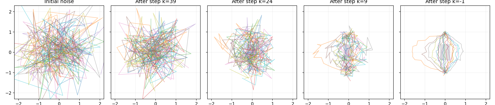
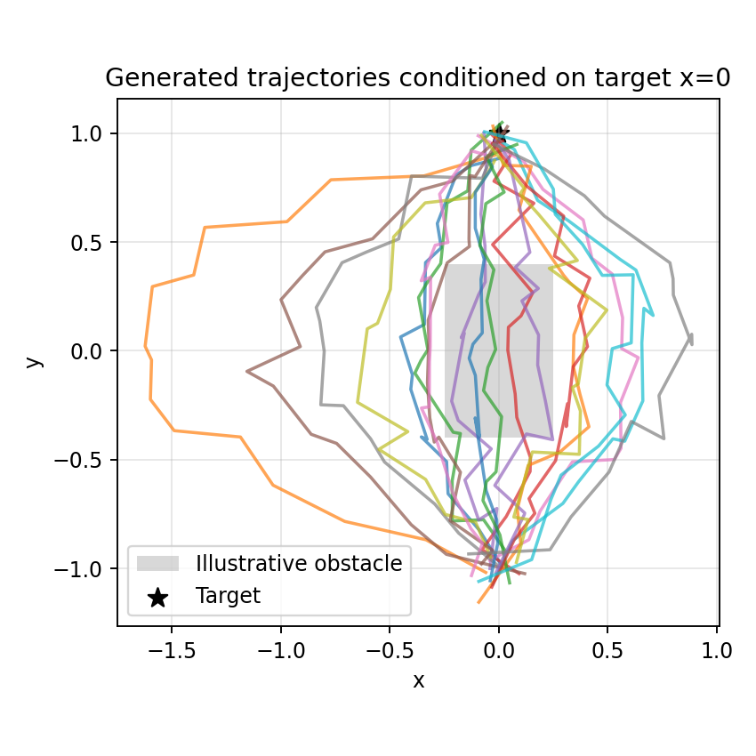

# Diffusion Policy：原理与复习

> 目标：弄清楚扩散策略为什么能生成机器人动作、网络究竟学习什么，以及它与普通行为克隆的区别。

## 1. 从行为克隆说起

行为克隆（Behavior Cloning，BC）把专家示范看成监督学习数据：给定观察 $o_t$，预测动作 $a_t$。

$$
\hat a_t=f_\theta(o_t)
$$

如果同一个场景有两种都合理的动作（例如从障碍物左侧或右侧绕过去），直接用 MSE 训练确定性回归网络，容易学到两种动作的条件均值。这个平均动作不一定合理，甚至可能撞上障碍物。

Diffusion Policy（DP）的思路不同：不只预测一个动作点，而是**学习在当前观察条件下，整段动作序列的分布**，再从这个分布采样。

$$
A_t\sim p_\theta(A\mid O_t)
$$

这里 $O_t$ 可以包含过去若干帧图像、关节位置、夹爪状态等；$A_t$ 是未来一段动作。DP 是模仿学习方法，不等于强化学习，也不自带碰撞安全保证。

## 2. 复习 DDPM：扩散到底是什么

设干净样本为 $x_0$，扩散总步数为 $K$。正向过程逐步加高斯噪声：

$$
q(x_k\mid x_{k-1})=\mathcal N\left(\sqrt{1-\beta_k}\,x_{k-1},\beta_k I\right)
$$

定义 $\alpha_k=1-\beta_k$，$\bar\alpha_k=\prod_{i=1}^{k}\alpha_i$，可以跳过中间加噪步骤，直接得到：

$$
\boxed{x_k=\sqrt{\bar\alpha_k}x_0+\sqrt{1-\bar\alpha_k}\epsilon},\qquad \epsilon\sim\mathcal N(0,I)
$$

理解这一个公式就够抓住正向扩散：$\sqrt{\bar\alpha_k}$ 决定信号保留多少，$\sqrt{1-\bar\alpha_k}$ 决定加入多少噪声。随着 $k$ 增加，通常信号减少、噪声增加。

反向过程则需要一个神经网络估计噪声：

$$
\hat\epsilon=\epsilon_\theta(x_k,k)
$$

经典噪声预测训练目标是：

$$
\boxed{\mathcal L=\mathbb E_{x_0,k,\epsilon}\left[\lVert\epsilon-\epsilon_\theta(x_k,k)\rVert_2^2\right]}
$$

网络不是记忆某一个样本，也不是每次直接预测最后的干净样本；它学习不同噪声等级下的去噪规律。反向采样时多次调用这个网络，数据逐渐从噪声变得有结构。

**容易混淆的地方：** $k$ 是模型内部的扩散步数，不是机器人运动时间 $t$；$K=50$ 表示去噪更新约 50 次，不表示机器人只运动 50 帧。

## 3. 从图像扩散变成动作扩散

从 DDPM 到 DP，最关键的变化是把生成对象从图像 $x_0$ 改成动作序列 $A_0$，并把机器人观察 $O_t$ 加入条件：

$$
\boxed{A_k=\sqrt{\bar\alpha_k}A_0+\sqrt{1-\bar\alpha_k}\epsilon}
$$

$$
\boxed{\hat\epsilon=\epsilon_\theta(A_k,k,O_t)}
$$

$$
\boxed{\mathcal L_{\mathrm{DP}}=\mathbb E\left[\lVert\epsilon-\epsilon_\theta(A_k,k,O_t)\rVert_2^2\right]}
$$

训练流程：从示范数据中取观察与动作序列 → 随机抽取扩散步数 $k$ → 对干净动作加入已知高斯噪声 → 网络预测噪声 → 比较预测噪声与真实噪声 → 反向传播更新网络参数。

推理流程：读取当前观察 → 随机初始化未来动作序列 → 多次条件去噪 → 输出动作序列 → 执行其中一段 → 重新观察环境。

## 4. 神经网络的输入、输出究竟是什么

二维轨迹实验设定：

```python
H = 16  # 每条轨迹 16 个点
D = 2   # 每个点是 x, y
K = 50  # 扩散步数
```

一条轨迹形状为 `[16, 2]`，展平后有 $16\times2=32$ 个标量；一个批次 256 条的形状为 `[256,16,2]`。这里“32 维特征”和“二维张量”是两个不同概念：前者指展平后的特征数，后者指张量有两个轴。

简化的 `NoiseNet` 输入来自：

| 输入 | 维数 | 用途 |
| --- | ---: | --- |
| 带噪轨迹展平 | 32 | 告诉网络当前轨迹数值 |
| 目标横坐标 | 1 | 告诉网络最终要到哪里 |
| 扩散步数正弦/余弦编码 | 32 | 告诉网络现在的噪声等级 |
| **合计** | **65** | `Linear(65,256)` |

代码中的网络：

```python
self.net = nn.Sequential(
    nn.Linear(65, 256),
    nn.SiLU(),
    nn.Linear(256, 256),
    nn.SiLU(),
    nn.Linear(256, 32),
)
```

输入 `[B,65]`，经过隐藏层，输出 `[B,32]`，最后重塑为 `[B,16,2]`。**输出 32 维，是因为要给轨迹中的每个 $x,y$ 坐标预测一个噪声值**，不是预测“左/右”分类标签。

`Linear(65,256)` 表示学习一个 $256\times65$ 的权重矩阵及 256 个偏置；`SiLU` 增加非线性。训练通过 `loss.backward()` 计算梯度、`optimizer.step()` 调整参数。

这个 Demo 用 MLP，方便入门；论文的 CNN-based DP 常用条件 1D U-Net 沿动作时间轴卷积，并利用观察条件调制中间特征；另有 Transformer-based 架构。不是所有 DP 网络都要把输入拼成 65 维。

## 5. 为什么按序列生成，而不是一步一动

模型一次预测未来 $T_p$ 步，但通常只执行其中 $T_a$ 步，再用最新观察重新预测，这就是**滚动时域控制（Receding Horizon Control）**。

| 符号 | 名称 | 作用 |
| --- | --- | --- |
| $T_o$ | Observation Horizon | 输入多少个历史观察 |
| $T_p$ | Prediction Horizon | 预测多长的未来动作序列 |
| $T_a$ | Action Horizon | 每次实际执行多少步 |

例如观察过去 2 帧，预测 16 步，只执行 8 步，然后重新观察。$T_a$ 越短，更新环境信息越频繁，但推理开销通常越高；$T_a$ 越长，计算频率较低，却可能更难及时修正误差。

## 6. 如何理解去噪结果图



图中每条线是一个 16 点的二维序列。初始状态是随机数组，点与点之间没有运动规律；迭代去噪后，线条逐渐具有示范轨迹的形状。图中的 `k=-1` 是旧绘图标签的表达问题，实际上是完成 `k=0` 那次更新后得到的结果。



左、右两组轨迹说明模型初步学到了多模态结构。不过，仅靠可视化不能证明避障可靠，也不能证明左右模式比例正确。原 Demo 中灰色矩形只用于绘图，**没有显式碰撞检测或避障损失**。


### 参考资料

- [Diffusion Policy 官方项目](https://diffusion-policy.cs.columbia.edu/)
- [Diffusion Policy 官方 GitHub](https://github.com/real-stanford/diffusion_policy)
- [论文：Diffusion Policy: Visuomotor Policy Learning via Action Diffusion](https://arxiv.org/abs/2303.04137)
- [CSDN 扩散策略学习文章](https://blog.csdn.net/v_JULY_v/article/details/143651718)
