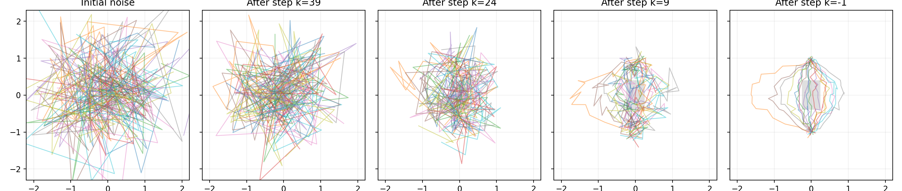
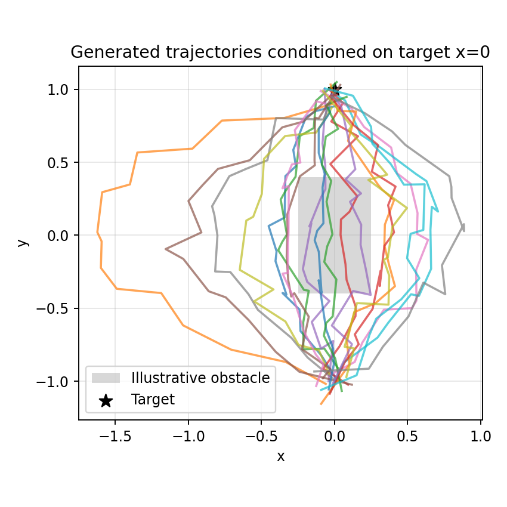

# 实验二：State-based Diffusion Policy Demo

## 一、实验目的

本实验使用 Diffusion Policy 官方提供的 State-based Demo，观察机器人在低维状态输入条件下如何生成动作并完成二维物体推动任务。学习重点不是直接复现大规模训练，而是看清**状态观测—动作序列预测—环境执行—重新观测**的闭环控制流程。

具体希望回答三个问题：一是 State-based 与 Vision-based 有什么区别；二是扩散网络输出的动作怎样真正作用于环境；三是为什么模型预测一段动作而不是只预测下一步。

## 二、实验环境与资料

| 项目 | 内容 |
| --- | --- |
| 实验名称 | State-based Diffusion Policy Demo |
| 方法 | 条件动作扩散、模仿学习 |
| 任务 | Push-T 二维物体推动任务 |
| 运行形式 | 官方 Google Colab 示例 |
| 输入形式 | 低维环境状态（State），不是原始相机图像 |
| 实验记录 | `实验二.mp4` |

官方入口：[State-based Colab Notebook](https://colab.research.google.com/drive/1gxdkgRVfM55zihY9TFLja97cSVZOZq2B?usp=sharing)  
项目源码：[real-stanford/diffusion_policy](https://github.com/real-stanford/diffusion_policy)

## 三、实验任务与原理

Push-T 任务中，控制器通过二维接触推动 T 形物体，使物体尽可能达到预定目标姿态。物体不仅要移动到目标附近，其方向也会影响任务完成程度，因此不同时间步的动作必须相互协调。

State-based Policy 不直接处理像素图，而是接收环境提供的数值状态。实际字段和维度以 Notebook 中的 observation 定义为准，可以包括控制器位置、物体位置和方向等信息。与 Vision-based 版本相比，它暂时绕开了视觉特征提取问题，更适合先研究动作生成过程。

Diffusion Policy 把未来动作序列看成待生成的数据：

$$
A_k=\sqrt{\bar\alpha_k}A_0+\sqrt{1-\bar\alpha_k}\epsilon
$$

利用当前观察 $O_t$ 作为条件，由网络预测动作噪声：

$$
\hat\epsilon=\epsilon_\theta(A_k,k,O_t)
$$

推理时从随机动作序列开始，反复预测噪声并更新序列，得到未来一段动作。控制器只执行其中指定的若干步，然后获取新状态并重新采样，实现闭环控制。

官方代码中低维策略接口通常把观察表示为 `[B, To, Do]`，实际执行动作为 `[B, Ta, Da]`。这里 `To` 为观察窗口长度，`Ta` 为执行窗口长度，`Do`/`Da` 分别是状态与动作维度；网络内部的预测窗口可能比执行窗口长。

## 四、实验操作过程

### 4.1 打开并运行 Notebook

1. 进入官方 State-based Colab，检查当前运行环境是否支持所需依赖。
2. 按 Notebook 顺序执行初始化、数据或模型加载、策略推理和环境可视化单元。
3. 观察模型是否输出动作序列，环境是否能根据动作更新状态。
4. 保存环境运行视频，便于回放分析推动过程。

本次实验视频保存在知识库的 `assets/第四周实验/实验二.mp4`。

### 4.2 运行视频

<video controls preload="metadata" width="100%">
  <source src="../assets/第四周实验/实验二.mp4" type="video/mp4">
  浏览器不支持内嵌视频时，请使用下方链接打开。
</video>

[打开实验二视频](../assets/第四周实验/实验二.mp4)

> 若 Quartz 网站无法直接播放，请先确认文件名与路径一致，且 MP4 视频编码为浏览器常用的 H.264 视频与 AAC 音频。视频不必放进本笔记目录，只需保留在 `content/assets/第四周实验/` 即可。

### 4.3 观察闭环控制流程

在视频回放时，重点观察以下几个连续阶段：

| 阶段 | 观察重点 | 对应理解 |
| --- | --- | --- |
| 环境初始化 | 控制器、T 形物体、目标姿态的初始相对位置 | 当前环境状态 $O_t$ |
| 生成动作 | 策略读取状态并产生未来动作序列 | 条件扩散采样 |
| 动作执行 | 控制器移动并接触、推动物体 | 将生成动作作用于环境 |
| 状态变化 | 物体平移、旋转，位置关系发生变化 | 动作导致环境转移 |
| 再次规划 | 根据新的状态继续调整运动 | 滚动时域控制 |

## 五、实验现象与分析

### 5.1 为什么需要动作序列

推动物体不是单次接触即可完成的独立动作。控制器的靠近方向、首次接触位置、连续推动方向必须在时间上保持一定一致性。预测未来一段动作，可以让网络学习这种时间相关性。

不过预测不意味着一次执行全部动作。环境发生变化后，应利用新的状态重新规划；否则前面预测的动作2
### 5. 为什么扩散方法适合这类任务

一个物体可能从多个接触方向被推动到目标区域，因此同一状态下可能存在不同的合理行动方案。条件扩散模型能够表达多种动作模式，而简单的确定性回归可能将不同示范平均化。

这不表示扩散策略天然优于所有方法。实际效果仍取决于示范数据覆盖范围、动作表示、网络训练、噪声调度和控制环境。

## 六、与实验一的关系

实验一是一个离线的二维轨迹生成模型：输入目标横坐标，输出一段位置序列；它没有真实的环境状态更新，也没有物体接触和碰撞反馈。

实验二增加了真实的仿真闭环：策略每执行一段动作，环境的物体与控制器状态就会改变，下一轮动作必须根据新状态重新预测。

可以把两个实验的递进关系写成：

$$
\text{离线生成轨迹}\quad\longrightarrow\quad\text{根据环境状态生成并执行动作}
$$

因此实验一主要帮助理解噪声预测网络，实验二主要帮助理解扩散策略作为**机器人控制策略**的使用方式。

## 七、实验小结

这次 State-based Demo 把扩散模型从“离线生成数据”推进到“根据状态生成动作并控制环境”。与二维轨迹生成相比，最重要的新认识是：**动作预测必须与状态反馈一起构成闭环**。模型一次生成整段动作，但机器人只执行其中一部分，然后根据新的环境状态继续规划。

### 参考资料

- [官方 State-based Colab](https://colab.research.google.com/drive/1gxdkgRVfM55zihY9TFLja97cSVZOZq2B?usp=sharing)
- [Diffusion Policy 官方代码](https://github.com/real-stanford/diffusion_policy)
- [Diffusion Policy 原论文](https://arxiv.org/abs/2303.04137)
