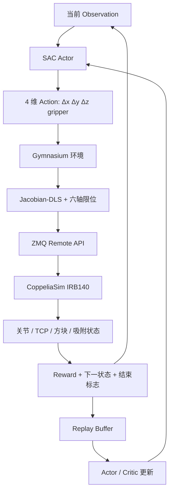

# 第五周实验学习总结：基于 SAC 的 IRB140 机械臂抓取与放置

> 本文记录从机械臂 Reach 环境，到 SAC 抓取、奖励函数调整及抓取—放置训练的学习过程。实验视频与损失曲线存放在 `content/assets/第五周实验/` 下。本文描述的是**环境实现与观察到的训练现象**；训练视频不能单独证明模型具有稳定的泛化成功率，最终效果需要独立评估。

## 1. 本周学习目标

在原有 ROS 2 + MoveIt 2 + CoppeliaSim IRB140 工作基础上，建立一个**独立于 ROS 2 的强化学习实验项目**，利用 Soft Actor-Critic（SAC）学习机械臂的末端控制，并进一步尝试对方块执行抓取与放置。

要实现的完整流程为：

```text
环境 Reset → 机械臂回 Home / 课程初始位置
          → 观察机械臂、方块和放置目标v
          → 接近抓取位姿
          → SAC 主动发出吸附动作
          → 抬升方块
          → 搬运至目标区域
          → 主动释放
          → 检查稳定放置
          → TCP 撤离
```

本周最大的认识是：**“仿真中可以通过脚本完成抓取”与“强化学习策略已经学会抓取”是两回事。** 前者证明任务机制可运行，后者必须通过策略推理与独立评估证明。

## 2. 实验环境和总体架构

| 组成 | 使用内容 | 作用 |
| --- | --- | --- |
| 仿真 | CoppeliaSim，ABB IRB140 | 提供六轴机械臂、工作台、方块及动力学环境 |
| 强化学习 | Stable-Baselines3 SAC | 学习动作策略 |
| 环境接口 | Gymnasium | 定义 `reset()`、`step()`、奖励和结束条件 |
| 仿真通信 | ZeroMQ Remote API | Python 与 CoppeliaSim 双向通信 |
| 运动控制 | Jacobian + 阻尼最小二乘（DLS） | 将末端增量转换为关节目标增量 |
| 训练监测 | TensorBoard | 查看训练指标和曲线 |
| 工程目录 | `/home/zyx/irb140_rl_project` | 与原 `robot_arm_core_ws` 隔离 |

系统数据流：




## 3. 从 Reach 到 Pick，再到 Pick and Place

| 任务 | Observation | Action | 最大步数 | 学习目标 |
| --- | ---: | ---: | ---: | --- |
| Reach / Random Reach | 21 | 3 | 200 | TCP 到达随机目标点 |
| Pick | 初版 28，课程版增加 `can_attach` 后 29 | 4 | 250 | 接近、吸附、抬升方块 |
| Pick and Place | 课程设计为 29 | 4 | 400 | 抓取、抬升、搬运、放置、撤离 |

> 维度说明：最初的 Pick/PickPlace 环境为 28 维；后续提出加入 `can_attach`，形成 29 维课程环境。具体运行前应以当前源码中的 `observation_space` 为准。两种不同维度的模型不能直接无修改加载。

### 3.1 SAC 的输入与输出

29 维状态设计如下：

| 观测项 | 维数 |
| --- | ---: |
| 6 个关节角度 | 6 |
| 6 个关节速度 | 6 |
| TCP 位置 | 3 |
| 方块位置 | 3 |
| 放置目标位置 | 3 |
| TCP 到抓取位姿向量 | 3 |
| 方块到放置点向量 | 3 |
| 方块是否附着 | 1 |
| 当前是否满足吸附条件 `can_attach` | 1 |
| **合计** | **29** |

动作向量：

\[
\mathbf a_t=[a_x,a_y,a_z,a_g],\qquad a_i\in[-1,1].
\]

前三维控制 TCP 的 XYZ 增量，第四维控制吸附机构：

- `a_g >= 0.5`：主动请求吸附。
- `a_g <= -0.5`：主动请求释放。
- 其余取值：维持当前吸附状态。

单步 TCP 增量限制为约 10 mm；末端位置动作经过 Jacobian-DLS 转换成六轴目标。第一版固定末端姿态，没有让网络学习末端旋转。

### 3.2 为什么采用 Jacobian-DLS

机械臂的末端速度与关节速度近似满足：

\[
\dot{\mathbf x}=J(\mathbf q)\dot{\mathbf q}.
\]

阻尼最小二乘可写为：

\[
\Delta\mathbf q = J^T(JJ^T+\lambda^2I)^{-1}\Delta\mathbf x.
\]

它的作用是把 SAC 输出的末端移动意图转换为可执行的关节增量，并在 Jacobian 接近奇异时改善数值稳定性。**DLS 不等于全局避障规划**：关节限位、工作空间和障碍物检查仍需要环境单独负责。

## 4. 实验过程与视频记录

> 以下视频和图片均使用相对路径。将本文件放在 `D:/robotics-wiki/content/学习总结.md`，素材保存在 `D:/robotics-wiki/content/assets/第五周实验/`，即可对应下面的路径。浏览器不支持嵌入播放时，可点击备用链接打开文件。

### 4.1 初期 SAC 训练：约 1,000 步的运动现象

这是初期实验记录，用于观察策略在尚未学会任务时的探索行为。训练初期可能出现小范围来回移动、频繁反向或无法接近方块的现象。**短视频本身不能证明策略成功或失败的总体概率。**

<video controls preload="metadata" width="100%">
  <source src="./assets/第五周实验/强化学习SAC.1000.mp4" type="video/mp4">
  浏览器不支持内嵌视频。
</video>

[▶ 打开：强化学习 SAC 1000 步视频](./assets/第五周实验/强化学习SAC.1000.mp4)

**学习要点：** SAC 最初输出的是探索动作，并不知道方块要如何抓取。网络初始化成功、机械臂能动，只说明训练链路已经打通。

### 4.2 初版 Pick 训练：10000 步未成功吸附

初版训练的典型评估现象为：

```text
success=False
stage=APPROACH
length=250
```

进一步读取 TensorBoard 和 Replay Buffer 后，得到以下记录：

| 指标 | 初版结果 |
| --- | ---: |
| 训练 Transition | 10,000 |
| Episode 数量 | 约 40 |
| 训练吸附次数 | 0 |
| 训练与评估成功率 | 0% |
| 最接近抓取位姿距离 | 约 63.5 mm |
| 进入有效吸附窗口并请求 close | 0 次 |

原有吸附窗口要求 XY 误差不超过 15 mm、高度误差不超过 12 mm，且满足姿态容差。训练从 Home 开始，需要跨越较长距离才能到达窗口；远距离无效 close 又受到较大惩罚，导致策略逐渐偏向**不吸附**。

因此，初版失败的主要原因不在于“仿真吸盘不能用”，而在于**探索过程几乎无法产生正向抓取经验**。

### 4.3 修改奖励函数与课程学习后的抓取过程

随后尝试通过更合理的奖励反馈与初始状态课程，改善抓取任务中的探索难题。这段视频文件名标记为 `sac+25000`，可作为训练过程的直观记录；**具体成功率及是否为确定性策略，应以评估日志为准**。

<video controls preload="metadata" width="100%">
  <source src="./assets/第五周实验/修改奖励函数后的抓取过程（sac+25000）.mp4" type="video/mp4">
  浏览器不支持内嵌视频。
</video>

[▶ 打开：修改奖励函数后的抓取过程（sac+25000）](./assets/第五周实验/修改奖励函数后的抓取过程（sac+25000）.mp4)

这部分的核心改进思路：

1. 从抓取位姿附近开始训练，再逐渐扩大初始距离。
2. 将无效 close 的惩罚调小，避免过早形成“永不吸附”策略。
3. 加入 10 cm、5 cm、吸附窗口、成功吸附、抬升高度等一次性里程碑奖励。
4. 在 Observation 中加入与实际吸附判定一致的 `can_attach`。
5. 完整评估时依然要求**策略主动请求吸附**，不能靠自动吸附制造成绩。

候选奖励结构：

\[
r_t=r_{\mathrm{progress}}+r_{\mathrm{milestone}}+r_{\mathrm{attach}}+r_{\mathrm{lift}}-r_{\mathrm{invalid}}-r_{\mathrm{action}}.
\]

上式用于理解奖励模块，并非对当前源码具体权重的逐项复刻。实际实验应记录每个奖励项的数值及是否启用。

### 4.4 抓方块训练损失图


[查看原始训练损失图](./assets/第五周实验/抓方块训练损失图.png)

**如何阅读：**

- `actor_loss`：策略网络的优化目标，数值不要求持续下降。
- `critic_loss`：价值网络的优化误差，不直接等于成功率。
- `ent_coef`：控制探索强度的温度参数。
- `ep_rew_mean`：平均奖励，仅说明优化目标的趋势。
- `task/success_rate`：独立任务成功率，更接近真正的学习结果。

需要同时查看成功率、最小抓取距离、成功吸附次数和抬升次数。**训练损失下降不等于机器人学会抓取。**

### 4.5 抓取与放置训练过程

完整任务要求方块真正经历吸附、抬升、移动、释放、稳定落桌和机械臂撤离，而不仅是 TCP 运动到目标点。

<video controls preload="metadata" width="100%">
  <source src="./assets/第五周实验/抓取与放置训练过程.mp4" type="video/mp4">
  浏览器不支持内嵌视频。
</video>

[▶ 打开：抓取与放置训练过程](./assets/第五周实验/抓取与放置训练过程.mp4)

对该视频的定量解释应结合日志中的 `attached`、`placed`、`is_success`、方块最终坐标及释放后稳定性判断。先前测试程序曾在受控动作下完成一次抓取与放置，最终位置误差约 7.246 mm；**那是环境机制测试结果，不是 SAC 的独立评估成绩。**

## 5. 为什么完整 Pick and Place 需要课程学习

从零开始同时探索“接近、吸附、抬升、搬运、释放、撤离”，成功奖励极难出现。因此设计从简单到复杂的初始状态。

| 课程 | 初始条件 | 主要学习行为 |
| --- | --- | --- |
| Pick C1 | TCP 位于抓取点附近 | 精确接近、主动吸附、抬升 |
| Pick C2 | TCP 距离增大 | 中距离接近与抓取 |
| Pick C3 | Home 或随机初始位置 | 完整自主 Pick |
| PP1 | 方块在 Reset 阶段已经安全附着，距放置点 5–8 cm | 对准、下降、主动释放、撤离 |
| PP2 | 方块已附着，距放置点 10–20 cm | 搬运、放置 |
| PP3 | Home、方块在桌面且未附着 | 完整自主抓取与放置 |

**特别注意：** PP1、PP2 的预附着只是为降低学习难度而设置的初始条件；不能把它算作“策略学会自主抓取”。最后应使用 PP3 在完整初始分布上进行独立评估。

课程间可迁移 Actor/Critic 网络权重；是否复用 Replay Buffer 取决于课程设计。当前设计使用**跨课程迁移权重，不迁移跨课程 Replay Buffer**，以减少不同初始分布造成的数据混杂。

## 6. Gymnasium 与 SAC 的关键知识

一次环境交互：

```python
observation, reward, terminated, truncated, info = env.step(action)
```

- `observation`：机械臂、方块、目标等当前状态。
- `reward`：本步动作产生的奖励。
- `terminated`：真正成功或明确失败。
- `truncated`：达到时间/步数上限等外部截断。
- `info`：吸附次数、最小抓取距离、失败原因等诊断字段。

SAC 将经验保存在 Replay Buffer 中：

\[
(s_t,a_t,r_t,s_{t+1},d_t).
\]

SAC 包含：

- **Actor**：根据当前状态产生连续动作策略。
- **Critic**：估计状态—动作价值。
- **Entropy temperature**：调节策略的随机性与奖励优化之间的平衡。

本项目的第四维动作虽然是连续输出，但通过阈值映射成吸附、释放与保持三种结果。这种设计实现简单，缺点是**任务中离散事件的探索概率较低**，需要课程、奖励和诊断指标配合。

## 7. 训练与评估命令速查

以下命令来自当前项目的任务约定；实际参数以本地 `--help` 与 README 为准。

```bash
cd ~/irb140_rl_project
source ~/miniconda3/etc/profile.d/conda.sh
conda activate irb140_rl
```

运行前在 CoppeliaSim 打开对应的独立场景文件并保持 Stopped，关闭其他控制后端；Python 环境会接管仿真步进。

```bash
# Pick 任务（基础入口）
python train_task.py --task pick --timesteps 10000
python evaluate_task.py --task pick --episodes 30

# 完整 PickPlace（基础入口）
python train_task.py --task pickplace --timesteps 10000
python evaluate_task.py --task pickplace --episodes 30

# 训练监控
 tensorboard --logdir runs --port 6006
```

课程版本请使用当前项目 README 记录的 C1/C2/C3、PP1/PP2/PP3 入口，不要将旧的 28 维权重直接用于新的 29 维网络。

## 8. 本次实验的主要问题与收获

### 8.1 收获

1. **搭建可学习的机器人环境**：不仅要让机器人动，还要让 `reset`、状态读取、奖励、结束条件和记录稳定工作。
2. **识别“机制成功”和“策略成功”**：受控脚本能抓放，不代表 SAC 学会；必须看未参与训练的任务回合。
3. **理解奖励函数对探索的影响**：如果正奖励难以触达，而无效 close 惩罚明显，策略可能优化成“不做抓取”。
4. **理解课程学习**：先降低任务初始难度，让模型获得有效经验，再逐步扩大状态分布。
5. **理解底层控制和上层学习的分工**：Jacobian-DLS 解决关节运动转换，SAC 学习任务动作，两者不是同一个算法。

### 8.2 仍需验证的问题

- 改进后的 SAC 是否在独立评估中达到稳定的抓取成功率？
- 是否存在只适用于固定方块位置的过拟合？
- PP3 是否能在 Home 起点自主完成所有阶段？
- 训练、评估是否严格使用相同的状态尺度与吸附判定？
- 是否记录了多个随机种子和完整的成功率、最终距离与置信区间？

## 9. 下一步计划

1. 保留初版失败的 10k SAC 实验作为基线。
2. 训练并独立评估 Pick C1，先确认出现真正的主动吸附与抬升。
3. 再将 Pick 从 C1 迁移到 C2、C3。
4. 使用 PP1、PP2 学习放置子任务，再在 PP3 验证完整自主行为。
5. 建立实验记录表：`seed / steps / success_rate / attach_count / final_error / episode_length`。
6. 如果未来研究低质量示教的 Diffusion Policy，可在成功策略基础上采集示教，但需要额外验证示教质量；SAC 与模仿学习不能混为一谈。

## 10. 总结

> 本周完成了从 IRB140 仿真运动控制，到 SAC Reach、Pick、PickPlace 环境构建及训练问题诊断的学习。最大的经验是：机器人“能动”和任务“能跑通”只是基础，强化学习是否真正有效，必须靠合理的奖励、课程学习，以及独立任务成功率验证。

---
