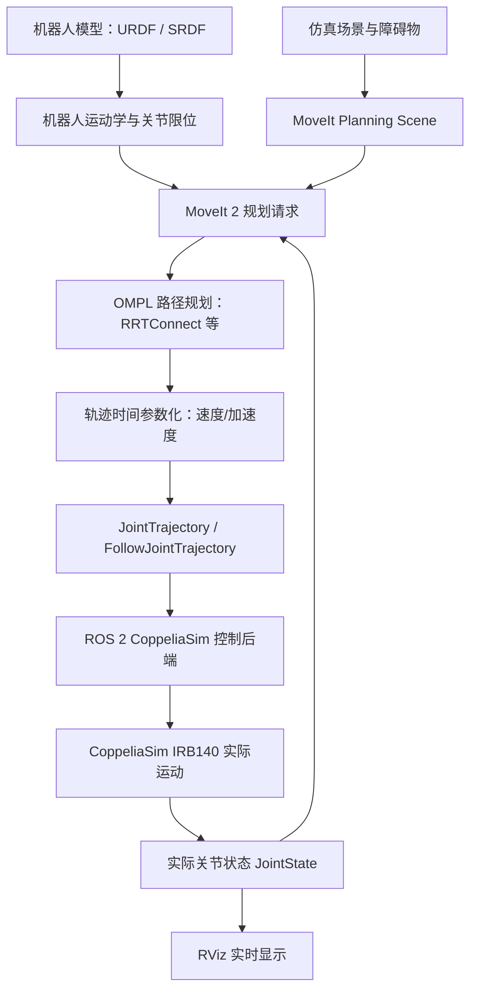
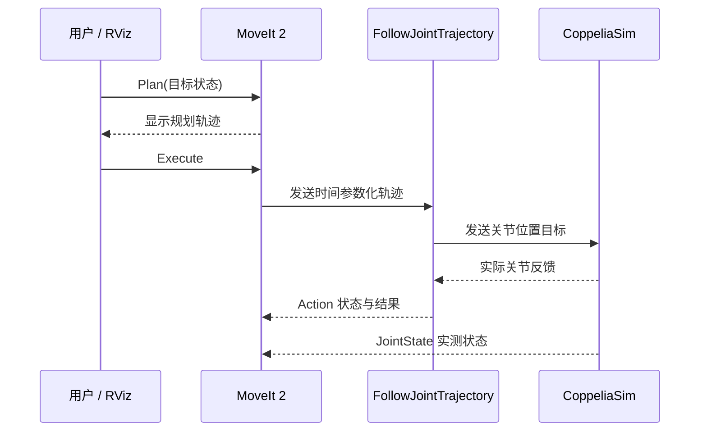

# IRB140 机器人学、运动规划与轨迹执行总结

> [!abstract] 这份笔记要解决的问题
> 1. RRT、RRT-Connect、RRT*、PRM、A* 究竟有什么区别？
> 2. 机器人为什么先规划“走哪里”，再规划“以多快的速度走”？
> 3. 六轴机械臂中的关节空间、任务空间、正逆运动学、Jacobian 和 TF 分别是什么？
> 4. 我实际完成的 **IRB140 + ROS 2 Jazzy + MoveIt 2 + CoppeliaSim** 项目，各组件分别做了什么？
> 5. 下一步做抓取、强化学习与 Diffusion Policy 时，哪些能力可以直接复用？

## 0. 一张图理解整个工程



**一句话：** URDF 规定“机器人是什么”，运动学告诉我们“给定关节角，手在哪里”，路径规划决定“经过哪里”，时间参数化决定“何时到哪里”，执行后端负责“让仿真机械臂真的动起来”，实际反馈负责“确认它是否动对了”。

---

# 第一部分：机器人学基础

## 1. 关节空间与任务空间

六自由度 IRB140 的关节状态可以写成：

$$
\mathbf q=[q_1,q_2,q_3,q_4,q_5,q_6]^\mathsf T
$$

其中 $q_i$ 为关节角（单位通常为 rad）。这是 **关节空间（Joint Space）**。

机械臂末端位姿则属于 **任务空间／笛卡尔空间（Task Space）**：

$$
\mathbf T_{\mathrm{base}}^{\mathrm{tool}} =
\begin{bmatrix}
\mathbf R & \mathbf p\\
\mathbf 0^\mathsf T &1
\end{bmatrix}
$$

- $\mathbf p=[x,y,z]^\mathsf T$：末端位置。
- $\mathbf R\in SO(3)$：末端朝向。
- 同一个末端位置，可能对应多组关节角；有时也可能不可达。
- **仅有末端位置相同，不代表末端姿态相同。** 抓取任务通常两者都重要。

| 比较 | 关节空间 | 任务空间 |
|---|---|---|
| 目标形式 | 六个关节角 | 末端位置和姿态 |
| 典型命令 | J1 从 0° 到 +5° | TCP 到方块上方 |
| 优点 | 限位和控制直接、易采样 | 易描述抓取、装配等任务 |
| 难点 | 人不易直观设计姿态 | 需要逆运动学、可达性与姿态约束 |

### 1.1 路径规划的真实维度

在不考虑冗余约束的情况下，IRB140 的六关节规划变量是 $\mathbf q\in\mathbb R^6$（旋转角可能具有周期性，实际配置空间还要考虑关节类型及限位）。

这意味着在 RViz 中看到的末端三维曲线，只是六维关节空间路径经过正运动学后的投影。**TCP 看起来绕开障碍物，不代表肘部、腕部等连杆没有碰撞。**

## 2. 正运动学 FK

**问题：给定六个关节角，求 TCP 的位置和姿态。**

$$
\mathbf T_0^6(\mathbf q)=\mathbf T_0^1(q_1)\mathbf T_1^2(q_2)\cdots\mathbf T_5^6(q_6)
$$

再考虑末端工具的固定变换：

$$
\mathbf T_0^{\mathrm{tool}}(\mathbf q)=\mathbf T_0^6(\mathbf q)\mathbf T_6^{\mathrm{tool}}
$$

这也是为什么 URDF 中的 `joint_6_to_tool0` 必须正确：它会影响每一个 TCP 位姿结果。

**本项目实践：** 将 CoppeliaSim 导出的机器人模型规范化为 `base_link → ... → link_6 → tool0`，并用多组单关节及组合姿态，比较 URDF FK 与 CoppeliaSim 实际连杆/TCP 位姿。项目报告显示最差 TCP 位置误差约 **1.476 μm**、朝向误差约 **0.0000616°**。这些是已报告的 M1 仿真对齐测试结果，并非机器人的现实制造精度。

## 3. 逆运动学 IK

**问题：已知想要的 TCP 位姿，求可能的六个关节角。**

$$
\mathbf q^*\ \text{使得}\ f(\mathbf q^*)\approx\mathbf T_{\mathrm{target}}
$$

需要同时考虑：

- 目标是否位于可达工作空间。
- 是否存在多组 IK 解（肘上/肘下等构型）。
- 是否触碰关节限位、自碰撞或环境碰撞。
- IK 解是否靠近奇异位形。

**本项目：** MoveIt 2 使用 KDL 运动学插件；`arm` 规划组由 `base_link` 到 `tool0` 的运动链组成。KDL 能求解运动学，不等于已经保证每条轨迹都没有碰撞。

## 4. Jacobian：关节速度与末端速度之间的桥梁

$$
\begin{bmatrix}\mathbf v\\\boldsymbol\omega\end{bmatrix}
=\mathbf J(\mathbf q)\dot{\mathbf q}
$$

- $\dot{\mathbf q}$：六轴关节角速度。
- $\mathbf v$：TCP 线速度。
- $\boldsymbol\omega$：TCP 角速度。
- $\mathbf J$：几何 Jacobian 矩阵，通常为 $6\times6$。

对于只考虑 TCP 位置变化的控制任务，可取 Jacobian 的位置部分 $\mathbf J_p\in\mathbb R^{3\times6}$。

### 4.1 阻尼最小二乘 DLS

机器人接近奇异位形时，直接求逆可能导致关节速度极大。一个常用的稳定方法是：

$$
\Delta\mathbf q=\mathbf J^\mathsf T
\left(\mathbf J\mathbf J^\mathsf T+\lambda^2\mathbf I\right)^{-1}
\Delta\mathbf x
$$

对于位置控制，式中的 $\mathbf J$ 可替换为 $\mathbf J_p$、$\Delta\mathbf x$ 为三维 TCP 增量。$\lambda$ 是阻尼系数。

**本项目的 SAC Reach：** 网络输出归一化的三维 TCP 增量 $[\Delta x,\Delta y,\Delta z]$，由 Jacobian+DLS 转成六轴关节目标，再通过 CoppeliaSim 动态位置控制执行。**因此 SAC 不是直接学六维关节力矩控制，而是学一层 TCP 增量策略。**

## 5. 坐标变换、TF 与四元数

常见坐标系：

- `world`：仿真世界基准。
- `base_link`：机械臂底座坐标系。
- `link_6`：第六连杆坐标系。
- `tool0`：工具参考坐标系。
- `PickCube`：物体参考坐标系。

若有一物体在 world 下的位姿 $\mathbf T_W^O$，机器人底座在 world 下的位姿 $\mathbf T_W^B$，则物体在 base 下的位姿为：

$$
\mathbf T_B^O=(\mathbf T_W^B)^{-1}\mathbf T_W^O
$$

**重点：SRDF 的 fixed virtual joint 只说明 `world` 与 `base_link` 的关联关系，不会神奇地把非零安装位姿自动应用好。** 项目中单独核对了 world→base_link 静态变换，而且必须避免重复叠加。

ROS 中姿态常用四元数 $q=(x,y,z,w)$ 表示。**$(0,0,0,1)$ 是单位旋转**，不是“位置坐标全为零”。

---

# 第二部分：路径规划算法

## 6. 先理解什么是配置空间 C-space

机器人的一个状态可用 $\mathbf q$ 表示。把所有符合关节限位的状态构成配置空间 $\mathcal C$：

$$
\mathcal C_{\mathrm{free}}=\{\mathbf q\in\mathcal C:\text{robot at }\mathbf q\text{ is collision-free}\}
$$

规划目标是找到从 $\mathbf q_{start}$ 到 $\mathbf q_{goal}$ 的连续路径：

$$
\mathbf q(s),\quad s\in[0,1]
$$

并保证每个路径状态（以及路径段的连续运动）都满足约束。

> [!important] 两层碰撞检查
> **自碰撞**：机械臂自己的不同连杆相撞。  
> **环境碰撞**：机械臂与桌面、地面、方块或其他障碍物相撞。  
> 只通过自碰撞检查，并不代表已经具有真实工作台的避障能力。

## 7. RRT：快速探索随机树

**英文：Rapidly-exploring Random Tree。**

RRT 通过不断在配置空间随机采样，把一棵树逐渐向未探索区域扩展。

### 7.1 基本步骤

1. 把起点 $\mathbf q_{start}$ 放进树 $T$。
2. 在配置空间随机采样一个状态 $\mathbf q_{rand}$。
3. 找出树中离它最近的节点 $\mathbf q_{near}$。
4. 从 $\mathbf q_{near}$ 朝 $\mathbf q_{rand}$ 推进一小步得到 $\mathbf q_{new}$。
5. 若这段连线无碰撞，加入树中。
6. 重复，直到能够连到目标或超时。

```text
起点 ●──●──●
          ├──●──●
          │      └──● ... 目标
          └──●
```

在常见完整性假设下，RRT 是**概率完备**的：如果存在可行解，随着采样增加，找到解的概率趋近 1；但有限时间内不保证成功，也**不保证路径最短**。

**适用：** 高维、多障碍物环境中快速寻找一条可行路径。

## 8. RRT-Connect：双向快速连接

**核心改进：从起点和终点同时长树，并尝试让两棵树相连。**

```text
起点树  ●──●──●───╮
                  ╰──●──●  目标树
```

典型过程：

1. 从起点建立树 $T_a$，从终点建立树 $T_b$。
2. 随机采样并扩展 $T_a$ 一步。
3. 让 $T_b$ 尽可能连续向新节点延伸（Connect）。
4. 如果两棵树连通，则得到路径。
5. 交换两棵树的角色，继续迭代。

**相对 RRT 的优点：** 经常更快得到首条可行路径，尤其适合单次机械臂运动规划。

**代价：** 路径可能弯曲或绕远，通常还需路径简化和时间参数化。

**本项目：** M2 使用 OMPL 的 **RRTConnect**，规划服务返回 `SUCCESS`，曾输出一条 **33 点的时间参数化轨迹**。这不是“每次固定 33 点”，而是某次具体测试的结果。

## 9. RRT*：不断改进路径质量

RRT* 在 RRT 的基础上增加了“选择更优父节点”和“重连（Rewire）”。

每插入新节点时：

1. 搜索附近的一组节点，而不仅是最近一个节点。
2. 选择到达新节点总代价较低的父节点。
3. 尝试把其他邻近节点改接到新节点，从而降低整棵树的路径代价。

常见路径代价：

$$
J=\int_0^1 \left\|\frac{d\mathbf q}{ds}\right\|ds
$$

这是关节空间长度的一种写法。也可以为能耗、风险、距离障碍物的安全裕度等设计代价，但每种代价都需要仔细定义。

在合适的数学条件下，RRT* **渐近最优**：计算时间增加时，最佳解趋近全局最优；**不表示运行几秒后必然得到最优路径**。

**与 RRT-Connect 的取舍：**

- 只想快速找到可行运动：常优先 RRT-Connect。
- 愿意花更多规划时间持续改善路径代价：考虑 RRT*。

## 10. PRM：概率路线图

**英文：Probabilistic Roadmap Method。**

PRM 更像先绘制“路网”，然后在这张路网上查询起点到终点的路径。

### 10.1 两阶段

**预处理：**

1. 在无碰撞空间采样很多节点。
2. 连接邻近且连线无碰撞的节点。
3. 形成路线图（Roadmap）。

**查询：**

1. 把新起点、终点接入路线图。
2. 用图搜索找到一条连接路径。

```text
●────●────●
│  ╲ │   ╱│
●────●───● │
 ╲   │    ╲●
  ●──●────●
```

**特点：** 适合**同一静态环境下多次规划查询**，因为构建好的路网可以复用。单次查询是否更快还取决于建图成本、采样密度、环境复杂度和实现方式。

在标准假设下，PRM 具有概率完备性；经典 PRM 本身不保证渐近最优（PRM* 等变种讨论最优性）。

## 11. A*：启发式图搜索

A* 不是随机采样树，而是在一个**已经离散化的图／网格**上搜索。

每个候选节点的评价函数：

$$
 f(n)=g(n)+h(n)
$$

- $g(n)$：从起点到 $n$ 已经花费的代价。
- $h(n)$：从 $n$ 到目标的估计代价（启发函数）。

如果启发函数满足可采纳性（不高估剩余真实代价）等必要条件，并采用适当的图搜索实现，A* 可以在该图上找到最优路径。

**注意：图上的最优 ≠ 连续六维机械臂空间中的全局最优。** 六轴空间做精细网格划分容易遭遇维度灾难，所以工业机械臂连续配置空间规划常优先使用 OMPL 采样方法；A* 则在移动机器人栅格路径规划、启发式搜索和已构建图搜索中很常用。

## 12. 五种算法对比表

| 算法 | 主要结构 | 面对新查询 | 主要优点 | 主要局限 | 常见用途 |
|---|---|---|---|---|---|
| RRT | 单棵随机树 | 重新扩展 | 实现直观，探索高维空间 | 路径质量未优化 | 单次可行路径 |
| RRT-Connect | 双向随机树 | 重新扩展 | 通常快速找到第一条路径 | 不保证最短 | 六轴机械臂运动 |
| RRT* | 可重连随机树 | 可持续优化 | 渐近最优性质 | 规划开销通常更大 | 路径质量优化研究 |
| PRM | 预构建随机路网 | 可复用路网 | 静态场景多次查询方便 | 建图成本、动态变化需处理 | 多次查询的工作站 |
| A* | 离散图/网格 | 在图上搜索 | 有明确启发式与图最优性条件 | 高维连续空间离散成本高 | 栅格导航、图路径搜索 |

**记忆口诀：** RRT“长一棵树”，RRT-Connect“两边长树并连接”，RRT*“边长树边重接优化”，PRM“先修路网再找路”，A*“沿着启发式最有希望的图节点搜索”。

## 13. 我该选哪个算法？

- **你的 IRB140 日常 Plan：** 优先从已经验收的 `RRTConnect` 开始。
- **同一工作台上反复更换抓取/放置位置：** 可实验 PRM 是否有优势。
- **研究路径长度优化：** 考虑 RRT*，但公平比较应设置相同时间预算、碰撞检测精度及任务集。
- **研究移动底盘二维路径：** A* 非常值得学。
- **论文对照实验：** 不要只比较“某次规划是否成功”；至少比较规划时间、成功率、路径长度、执行总时长、碰撞次数及可重复性。

---

# 第三部分：路径规划不等于速度规划

## 14. 三个容易混淆的概念

### 14.1 路径（Path）

仅规定几何顺序：

$$
\mathbf q(s),\quad s\in[0,1]
$$

它告诉机器人“经过哪些关节状态”，但**不规定多久到达**。

### 14.2 轨迹（Trajectory）

给路径赋予时间：

$$
\mathbf q(t),\quad 0\le t\le T
$$

由此可得速度、加速度：

$$
\dot{\mathbf q}(t)=\frac{d\mathbf q}{dt},\qquad
\ddot{\mathbf q}(t)=\frac{d^2\mathbf q}{dt^2}
$$

### 14.3 控制（Control）

执行器根据轨迹目标和实测反馈产生具体动作。比如你目前的 CoppeliaSim 后端以约 50 Hz 发送插值关节目标；仿真的动态位置控制器负责让模型跟随目标。**发布轨迹并不等于实际机械臂就能完美跟踪。**

```mermaid
flowchart LR
    A[几何路径 q(s)] --> B[时间参数化 s(t)]
    B --> C[时间轨迹 q(t)]
    C --> D[关节位置/速度控制]
    D --> E[实际关节反馈]
```

## 15. 时间参数化的数学直觉

将路径写成 $\mathbf q(s)$，再定义 $s(t)$，则：

$$
\dot{\mathbf q}=\frac{d\mathbf q}{ds}\dot s
$$

$$
\ddot{\mathbf q}=\frac{d^2\mathbf q}{ds^2}\dot s^2+
\frac{d\mathbf q}{ds}\ddot s
$$

所以速度规划需要为路径找到合适的 $\dot s$ 和 $\ddot s$，使每个关节满足：

$$
|\dot q_i|\le v_{i,\max},\qquad
|\ddot q_i|\le a_{i,\max}
$$

有时还需考虑关节 jerk（加加速度）、力矩或碰撞速度约束。

### 15.1 最常见的速度规划方式

| 方式 | 思想 | 适用场景 |
|---|---|---|
| 梯形速度规划 | 加速—匀速—减速 | 单轴简单点到点 |
| 三角形速度规划 | 距离太短，达不到最高速度 | 小位移运动 |
| S 曲线规划 | 限制 jerk，平滑加速度变化 | 更重视冲击与振动 |
| 多轴时间参数化 | 保留几何路径，同时满足各轴约束 | MoveIt 规划后轨迹生成 |

**区分：** MoveIt 生成的时间参数化轨迹不一定是你想象中的每个关节独立梯形速度曲线。多轴耦合路径需要统一考虑约束。

## 16. 梯形速度规划例子

假设一个关节需要运动 $\Delta q$，速度限制 $v_{max}$、加速度限制 $a_{max}$，起点终点速度都为 0。

达到最大速度所需的加速距离：

$$
 d_a=\frac{v_{max}^2}{2a_{max}}
$$

若 $|\Delta q|\ge 2d_a$，可采用梯形速度：

$$
T=2\frac{v_{max}}{a_{max}}+
\frac{|\Delta q|-v_{max}^2/a_{max}}{v_{max}}
$$

若位移较小，达不到最大速度，则为三角形速度：

$$
T=2\sqrt{\frac{|\Delta q|}{a_{max}}}
$$

这是一维理想化模型；六轴同时运动以及仿真控制器跟踪会更复杂。

**与本项目联系：** M2 初次规划曾因缺少关节加速度上限，导致规划路径本身存在，但轨迹时间参数化失败。补充六轴规划用加速度上限（报告中为保守的 $1.0\ \mathrm{rad/s^2}$ 临时值）后，规划服务才返回完整的成功结果。

> [!warning] 规划参数不等于执行器实测能力
> M2 的 `1.0 rad/s²` 是配置和规划阶段使用的保守参数，不能据此推断 IRB140 物理电机的真实能力。正式部署必须对控制模式、最大速度、加速度和负载进行标定与验证。

## 17. `JointTrajectory` 里到底包含什么？

常见的 ROS 2 消息 `trajectory_msgs/JointTrajectory`：

```yaml
joint_names: [joint, joint_2, joint_3, joint_4, joint_5, joint_6]
points:
  - positions: [0.0, 0.0, 0.0, 0.0, -1.5708, 0.0]
    velocities: [0.0, 0.0, 0.0, 0.0, 0.0, 0.0]
    time_from_start: {sec: 0, nanosec: 0}
  - positions: [0.0873, 0.0, 0.0, 0.0, -1.5708, 0.0]
    velocities: [0.0, 0.0, 0.0, 0.0, 0.0, 0.0]
    time_from_start: {sec: 5, nanosec: 0}
```

**注意：** 以上是教学示例，不是本项目某次真实规划输出；实际时间参数化轨迹往往包含多个中间点和非零中间速度。

`FollowJointTrajectory` 是 Action 接口，不是“普通 Topic”。它允许提交目标、获取反馈、接收结果和取消正在执行的运动任务。

## 18. 执行误差如何计算？

设每时刻的期望角度为 $q_i^{des}(t)$，实际反馈角度为 $q_i^{act}(t)$：

$$
e_i(t)=q_i^{act}(t)-q_i^{des}(t)
$$

常见指标：

$$
E_{max}=\max_{i,t}|e_i(t)|,\qquad
E_{final}=\max_i|e_i(T)|
$$

还可以计算 RMS 误差、超调、稳定时间、超时次数和轨迹中断率。

**本项目 M3 实测：** 独立场景下仅执行一次 J1 相对起点 +5°／5 秒轨迹，报告结果为：

| 指标 | 报告值 |
|---|---:|
| Action | accepted，`STATUS_SUCCEEDED` |
| 结果码 | `SUCCESSFUL (0)` |
| J1 最终角度误差 | 约 `0.00002544°` |
| 最大跟踪误差 | 约 `0.02098°` |
| 实测反馈数 | 109 |
| 其他轴 | 漂移非常小 |

这些证明**该次受限仿真轨迹执行成功**，不能直接推广成任意路径、任意速度或真实机器人上的精度保证。

---

# 第四部分：MoveIt 2 如何使用这些知识

## 19. URDF、SRDF、Planning Scene 的分工

| 项目 | 解决的问题 | 本项目对应 |
|---|---|---|
| URDF | 连杆、关节、几何、惯性与关节限位等模型 | `irb140_description` |
| SRDF | 规划组、命名姿态、虚拟关节与碰撞豁免等语义 | `arm`、`home` |
| Kinematics | FK/IK 求解 | KDL |
| Planning Scene | 当前机器人状态、障碍物与附着物体 | M2 仅规划环境；工作台完整同步属于后续工作 |
| OMPL | 搜索无碰撞几何路径 | RRTConnect/RRTstar 配置 |
| Time parameterization | 速度、加速度约束与时间戳 | M2 轨迹参数化 |
| Controller mapping | 将轨迹交给哪个 Action | `/robot_arm/follow_joint_trajectory` |

### 19.1 自碰撞矩阵为什么不能乱禁用？

MoveIt Setup Assistant 可自动生成自碰撞豁免，但某些 `reason="Never"` 组合可能没有得到充分验证。你的 M2 审计移除了 **6 组未经证明的跨级碰撞豁免**，采用更保守的碰撞设置。

**原则：** 为了让 Plan 成功而随便关闭碰撞检查，是错误的工程处理方法。

## 20. 在 RViz 点击 Plan 与 Execute 的区别

**Plan：**

1. 获取起点（理想情况下是机器人当前实测关节状态）。
2. 读取目标关节角度或者末端目标位姿。
3. 通过 IK、碰撞检查、OMPL 生成路径。
4. 用时间参数化生成可执行轨迹。
5. 在 RViz 展示规划结果。

**Execute：**

1. MoveIt 选择映射的轨迹控制器。
2. 通过 `FollowJointTrajectory` Action 发送轨迹。
3. 后端校验轨迹和执行许可。
4. CoppeliaSim 关节动态跟踪目标。
5. 实际关节反馈更新 MoveIt 与 RViz。



> [!note] 实际项目验收边界
> M2 已完成规划服务和 RViz 的 planning-only 验收；M3 已完成受限 J1 +5° 的 Action 实际运动验收，MoveIt 控制器链路发现与映射也已核对。**M3 报告明确指出：当时尚未通过 RViz 的 MoveIt Execute 发出额外真实运动。** 后续如果进行了新的交互式 Execute 联调，应另写结果，不要把“连接验证”当作“已执行成功”。

---

# 第五部分：我这次 IRB140 项目的完整复盘

## 21. 项目软硬件架构

| 层次 | 项目使用内容 |
|---|---|
| 宿主系统 | Windows 11 |
| Linux 环境 | WSL2 Ubuntu 24.04 |
| ROS | ROS 2 Jazzy |
| 规划工具 | MoveIt 2 + OMPL + KDL |
| 仿真软件 | CoppeliaSim 4.10 |
| 机器人 | ABB IRB140，六轴 |
| 远程通信 | ZeroMQ Remote API |
| 工作区 | `/home/zyx/robot_arm_core_ws` |
| 机器人描述包 | `irb140_description` |
| 规划配置包 | `irb140_moveit_config` |
| 轨迹执行核心包 | `robot_arm_control_core` |

场景中的主要对象包括 `WorkTable`、`PickCube`、`PreGrasp_A`、`PrePlace_B`、`Floor`。在已完成的 M1–M3 阶段，它们不等于已经全部同步为 MoveIt 的实际碰撞对象。

## 22. M1：为什么最先验证 URDF 和 FK？

原始难点：如果 URDF 和 CoppeliaSim 的各关节坐标轴、方向、连杆几何、基座变换不完全一致，MoveIt 会规划出“在 RViz 看起来对，但在仿真里错”的动作。

**这次做法：**

1. 使用 CoppeliaSim 自带 URDF 导出。
2. 规范化关节与连杆命名。
3. 校准世界坐标、底座和 TCP。
4. 单关节正负角与多关节联合姿态逐一比较。
5. 使用独立场景副本，不覆盖原始场景。
6. 对比实际 CoppeliaSim 位姿与离线 FK。

**我的学习收获：** 运动规划的第一步不是选 RRT，而是先保证**模型对应同一个真实／仿真的机器人**。

## 23. M2：从“模型正确”走到“路径可规划”

配置内容：

- SRDF `arm`：`base_link → tool0`。
- 精确匹配仿真初始姿态的 `home`。
- world→base_link 静态变换。
- KDL 运动学求解器。
- OMPL `RRTConnect`/`RRTstar` 配置。
- 审计自碰撞矩阵，收紧未经证明的碰撞豁免。
- 配置六轴速度与加速度限制。
- 保持 planning-only 与执行模式隔离。

**遇到的问题与解决：**

| 问题 | 真实原因或教训 |
|---|---|
| MoveIt 包不被 `ros2 pkg list` 发现 | 生成的 `package.xml` 作者邮箱为空，构建失败；需修复 Manifest 并重新构建 |
| RViz 计划功能不可用 | 先确认 MotionPlanning、目标状态、MoveGroup 服务和规划日志；不要靠猜测修改 URDF |
| 几何路径有了但时间参数化失败 | 六轴加速度上限未设置 |
| 自动生成 demo 潜在冲突 | 必须隔离 FakeSystem、真实状态源和实际执行后端 |
| 路径可能忽略部分碰撞 | 自动生成的自碰撞豁免应审核，而不是全部接受 |

**验收结果：** OMPL 生成并成功时间参数化了一条 33 点轨迹，规划阶段不触发实际仿真运动。

## 24. M3：从“规划成功”走到“机械臂真的动了”

M3 搭建了：

- 标准 `/robot_arm/follow_joint_trajectory` Action Server。
- CoppeliaSim ZMQ 六轴位置目标下发。
- 按时间插值，而非直接把关节跳到终点。
- CoppeliaSim 实测关节状态的 ROS 2 发布与固定名称映射。
- 唯一控制源、仿真状态检查、关节限位与安全停止机制。
- 默认关闭的运动执行授权。

**最典型的调试案例：**

第一次提交 J1 +5°／5 s 目标被拒绝。最终根因是：

```text
simulation_state = 0
```

即 **CoppeliaSim 仿真仍然停止**。后端按设计拒绝了运动，而不是关节名称或 Action 地址错误。

在独立场景副本中启动仿真后，完成了一次真实的 +5° 运动，结果如第 18 节。

**这一阶段的学习收获：**

1. Action 被拒绝时，应查看服务端具体拒绝原因。
2. 能读到 `JointState` 并不代表仿真已经允许运动。
3. MoveIt 规划和后端真实执行是两项独立验收。
4. 机器人控制必须有反馈和取消机制，不能只负责写目标角。

## 25. M4 与后续研究：抓取不仅是再走一条路径

完整 Pick and Place 至少包含：


在程序中还需要：

- `WorkTable`、`Floor`、`PickCube` 真实碰撞几何与位姿同步。
- 吸附／夹爪状态与 MoveIt Attached Collision Object 同步。
- 抓取失败后的恢复或停止逻辑。
- 方块是否落到指定位置的物体级验收。

**本项目另有独立 SAC 强化学习工程** `/home/zyx/irb140_rl_project`，它与 `robot_arm_core_ws` 隔离：SAC 的动作是三维 TCP 增量（抓取任务增加一个吸附/释放维度），通过 Jacobian+DLS 转化成关节动作。这与 OMPL 基于几何搜索的规划路径不同。

## 26. 对比：传统规划、强化学习、Diffusion Policy

| 维度 | MoveIt / RRTConnect | SAC 强化学习 | Diffusion Policy 模仿学习 |
|---|---|---|---|
| 学到的东西 | 不需训练，按约束搜索路径 | 根据状态和奖励学动作策略 | 从示教数据学动作分布/序列 |
| 输入 | 起点、目标、机器人模型、障碍物 | 状态观测 | 历史观测与示教动作分布 |
| 输出 | 几何路径与时间轨迹 | 当前动作或控制增量 | 一段预测动作序列 |
| 强项 | 约束清晰、可解释、可做碰撞检查 | 可通过交互适应复杂奖励 | 可学习复杂、多模态示教行为 |
| 局限 | 依赖场景模型和规划设置 | 探索与奖励设计困难 | 数据质量和示教覆盖范围敏感 |
| 你的角色 | **规划专家/对照基线** | **可选学习策略** | **低质量示教研究主线** |

注意：用 MoveIt 导出的路径当作示教可以训练 DP，但若数据只有理想化的直线点到点运动，学习任务可能太简单。未来实验需要更丰富的起点、目标、障碍和多路径分布。

---

# 第六部分：常用命令与排障

## 27. 检查 ROS 2 与工程包

```bash
source /opt/ros/jazzy/setup.bash
cd ~/robot_arm_core_ws
source install/setup.bash

ros2 pkg list | grep irb140
ros2 node list
ros2 topic list
ros2 action list
ros2 service list
```

构建时优先使用项目提供的虚拟环境构建脚本，以保持 CoppeliaSim Remote API 的 Python 依赖和入口解释器一致：

```bash
cd ~/robot_arm_core_ws
bash scripts/build_with_coppelia_venv.sh
source install/setup.bash
```

## 28. 查看实际关节状态

```bash
ros2 topic echo --once /robot_arm/actual_joint_states
ros2 topic echo --once /robot_arm/backend/joint_states
ros2 topic hz /robot_arm/actual_joint_states
ros2 topic echo --once /robot_arm/control_status
ros2 action info /robot_arm/follow_joint_trajectory
```

其中：

- `/robot_arm/backend/joint_states`：CoppeliaSim 原生命名。
- `/robot_arm/actual_joint_states`：映射到 MoveIt URDF 的 `joint`、`joint_2` … `joint_6`。
- 单位主要为 rad；角度换算 $\theta_{deg}=\theta_{rad}\cdot180/\pi$。

## 29. 规划专用模式

```bash
source /opt/ros/jazzy/setup.bash
source ~/robot_arm_core_ws/install/setup.bash
ros2 launch irb140_moveit_config planning_only.launch.py
```

适合练习 RViz MotionPlanning：选择规划组 `arm`，修改目标姿态并点击 **Plan**。该模式不能假装已经验证了真实运动。


---


# 第八部分：一页速记

| 名词 | 一句话解释 |
|---|---|
| FK | 已知关节角，计算末端位姿 |
| IK | 已知末端目标，寻找关节角 |
| Jacobian | 把关节速度映射到末端速度 |
| DLS | 用阻尼降低逆 Jacobian 在奇异附近的不稳定性 |
| TF | 管理不同坐标系之间的变换 |
| URDF | 机器人连杆和关节模型 |
| SRDF | MoveIt 的机器人语义配置 |
| C-space | 所有可能的机器人配置组成的空间 |
| RRT | 随机采样、探索式扩展树 |
| RRT-Connect | 起终点双向扩展、快速连接 |
| RRT* | 重连树结构、逐步优化代价 |
| PRM | 预构建无碰撞路网、供多次查询 |
| A* | 在图上用 $g+h$ 做启发式搜索 |
| Path | 只有几何顺序，不含时间 |
| Trajectory | 带时间、速度和可能的加速度的运动参考 |
| Time Parameterization | 给路径安排合法的时间变化规律 |
| Planning Scene | 规划器眼中的障碍物、机器人状态及附着物 |
| MoveIt 2 | 运动学、碰撞检测、规划和轨迹执行协调框架 |
| FollowJointTrajectory | 提交、反馈、取消和获取关节轨迹执行结果的 Action |
| CoppeliaSim | 实际执行与物理仿真所在平台 |

## 最重要的工程结论

> **“规划成功”不等于“执行成功”，“执行成功”不等于“碰撞安全已覆盖全部场景”，“吸附测试成功”也不等于“强化学习已经学会抓取”。**
>
> 我这次项目的核心收获，是把机器人运动系统拆成可独立验证的四层：**运动学模型 → 几何路径规划 → 时间轨迹与控制 → 实测反馈与任务验收**。

