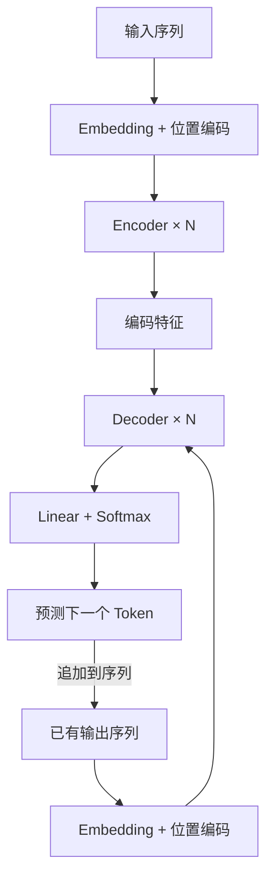
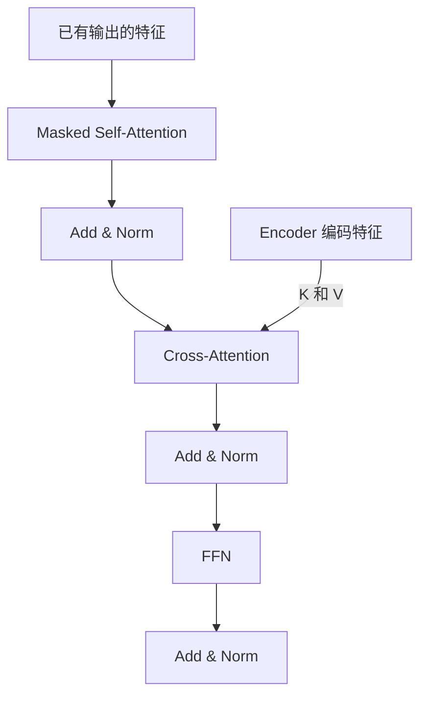
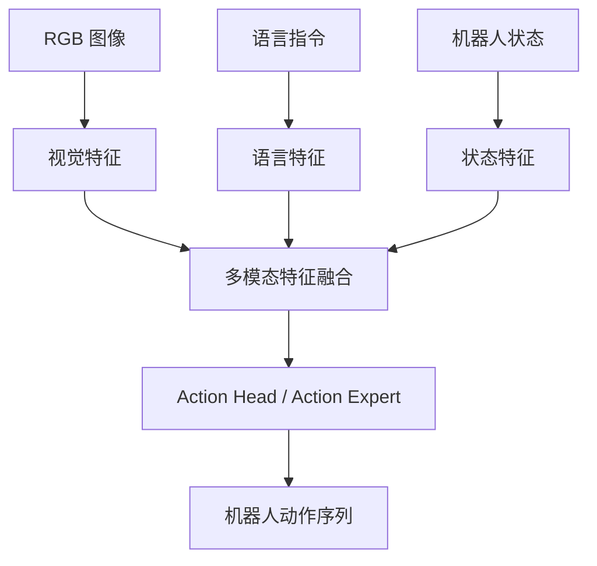

# 深度学习学习笔记：Transformer

> 学习目标：理解 Transformer 的数据流、注意力机制、编码器与解码器，以及它在具身智能中的应用。本文以原始 Transformer 为主，再介绍现代架构的区别。所有示例数值均为教学假设。

## 1. Transformer 是什么？

Transformer 是一种以注意力机制为核心的神经网络架构，由 2017 年论文 *Attention Is All You Need* 提出。它将输入转换成向量序列，通过注意力机制实现不同 Token 之间的信息交互，通过前馈网络进一步加工特征，最终完成翻译、文本生成、视觉识别或机器人动作预测等任务。

- CNN：利用卷积提取局部空间特征。
- RNN：通过循环状态处理序列信息。
- Transformer：利用注意力机制建立序列中不同位置之间的联系。

## 2. 整体框架



原始 Transformer 包含 Encoder 和 Decoder。Encoder 提取输入的上下文特征，Decoder 结合这些特征与已有输出预测下一个 Token。

## 3. 输入数据如何表示？

以“我 喜欢 机器人”为例，假设分词后得到三个 Token。

### 3.1 Tokenizer 与 Embedding

Tokenizer 将文字转换为 Token ID，例如 `[120, 352, 982]`。Embedding 根据 ID 查找可训练的向量表。

假设每个 Token 的特征维度为 4：

$$
X=\begin{bmatrix}1&0&1&0\\0&1&1&0\\1&1&0&1\end{bmatrix}\in\mathbb{R}^{3\times4}
$$

每一行对应一个 Token，每一列对应一个特征维度。单个特征维度通常没有人工指定的语义。

### 3.2 位置编码

原始 Transformer 将位置编码与词嵌入相加，使网络能够区分不同的词序。

$$X=E+P$$

现代模型还常使用旋转位置编码（RoPE）等方法，将位置信息引入注意力计算。

## 4. Self-Attention 自注意力机制

### 4.1 核心思想

自注意力解决的问题是：当前 Token 应该关注哪些 Token，以及应该从它们那里获取多少信息？

例如“苹果发布了手机”和“苹果是一种水果”中的“苹果”，初始词嵌入可以相同，但经过双向自注意力之后，会融合不同的上下文信息。

### 4.2 Q、K、V

$$Q=XW_Q,\quad K=XW_K,\quad V=XW_V$$

| 矩阵 | 含义 | 作用 |
|---|---|---|
| Q（Query） | 查询 | 当前 Token 需要什么信息 |
| K（Key） | 键 | 当前 Token 如何与查询匹配 |
| V（Value） | 值 | 当前 Token 提供什么信息 |

三个投影矩阵是训练得到的参数，而不是人为指定的语义规则。

### 4.3 注意力公式

$$\boxed{Z=\operatorname{softmax}\left(\frac{QK^T}{\sqrt{d_k}}\right)V}$$

计算分四步：

1. $QK^T$：向量点积，计算匹配分数。
2. 除以 $\sqrt{d_k}$：缩放分数，降低高维点积使 Softmax 饱和的风险。
3. Softmax：按行计算权重，每行权重之和为 1。
4. 乘以 V：对其他 Token 的值向量进行加权求和，得到新特征。

### 4.4 手算示例

假设投影后得到：

$$Q=\begin{bmatrix}1&0\\1&1\\0&1\end{bmatrix},\quad K=\begin{bmatrix}1&0\\1&2\\0&2\end{bmatrix},\quad V=\begin{bmatrix}2&1\\1&3\\4&2\end{bmatrix}$$

计算匹配分数矩阵：

$$QK^T=\begin{bmatrix}1&1&0\\1&3&2\\0&2&2\end{bmatrix}$$

第二行对应“喜欢”对三个 Token 的匹配程度 `[1, 3, 2]`。缩放并进行 Softmax：

$$a=\operatorname{softmax}([1,3,2]/\sqrt{2})\approx[0.1400,0.5760,0.2840]$$

其新特征为：

$$z_{喜欢}=0.1400[2,1]+0.5760[1,3]+0.2840[4,2]\approx[1.992,2.436]$$

注意力权重不是最终特征，乘以 V 后的结果才是新特征。

### 4.5 矩阵维度

设序列长度为 n，模型维度为 d，键维度为 $d_k$，值维度为 $d_v$。

| 数据 | 维度 |
|---|---|
| X | n × d |
| Q、K | n × $d_k$ |
| V | n × $d_v$ |
| 注意力权重 A | n × n |
| 输出 Z | n × $d_v$ |

注意力不会改变查询 Token 的数量，但可以改变特征维度。

### 4.6 输出特征有什么用？

注意力输出是融合上下文后的特征矩阵，不是最终文字，也不是机器人动作。它会继续进入后续网络，最终由任务输出层转化为具体结果。

```text
初始特征 → Attention 信息融合 → FFN 特征加工
          → 多层 Block → 任务输出层 → 预测结果
```

## 5. Multi-Head Attention 多头注意力

多个注意力头使用不同的投影参数，并行学习不同的信息交互方式。

$$head_i=Attention(XW_i^Q,XW_i^K,XW_i^V)$$

$$MHA(X)=Concat(head_1,\ldots,head_h)W_O$$

例如模型维度为 512，8 个注意力头，每头输出 64 维，拼接后恢复 512 维，再通过输出投影层。

## 6. Encoder 编码器

原始 Encoder Block 的结构：

```text
输入 X
  ↓
多头自注意力
  ↓
残差连接 + LayerNorm
  ↓
FFN 前馈神经网络
  ↓
残差连接 + LayerNorm
  ↓
输出特征
```

### 6.1 FFN

$$FFN(x)=\operatorname{ReLU}(xW_1+b_1)W_2+b_2$$

例如 512 → 2048 → 512。FFN 独立加工每个 Token 的特征，同一层中的各位置共享 FFN 参数。

### 6.2 残差连接与归一化

原始 Transformer 使用 Post-LN：

$$Y=LayerNorm(X+F(X))$$

残差连接改善梯度传播，LayerNorm 对每个位置的特征进行归一化。现代模型也常使用 Pre-LN 或 RMSNorm。

Encoder 可堆叠 N 层，最终得到包含上下文信息的编码特征 E。

## 7. Decoder 解码器

### 7.1 已有输出序列是什么？

以翻译“我喜欢机器人”为例，Encoder 一次性编码原文，Decoder 在推理阶段逐个生成 Token。

| 轮次 | Decoder 输入（已有输出） | 新预测 |
|---|---|---|
| 1 | BOS | I |
| 2 | BOS I | like |
| 3 | BOS I like | robots |
| 4 | BOS I like robots | . |
| 5 | BOS I like robots . | EOS |

BOS 表示开始，EOS 表示结束。每次生成的新 Token 都追加到已有序列。这个过程叫自回归生成。

### 7.2 Decoder Block



### 7.3 Masked Self-Attention

每个位置只能关注自身与之前的 Token，不能看到未来答案。

$$A=\operatorname{softmax}\left(\frac{QK^T}{\sqrt{d_k}}+M\right)$$

四个 Token 对应的因果掩码：

$$M=\begin{bmatrix}0&-\infty&-\infty&-\infty\\0&0&-\infty&-\infty\\0&0&0&-\infty\\0&0&0&0\end{bmatrix}$$

被禁止关注的位置经过 Softmax 后权重为零。

### 7.4 Cross-Attention 交叉注意力

区别在于 Q、K、V 的数据来源。设 D 是解码器当前特征，E 是编码器输出：

$$Q=DW_Q,\quad K=EW_K,\quad V=EW_V$$

Decoder 利用已有输出的信息，主动查询原文编码特征。例如已经生成 I like 时，可以从原文中获取与“机器人”有关的特征。

若原文长度为 n，目标序列长度为 m，则交叉注意力权重矩阵大小为 m × n，输出序列长度为 m。

### 7.5 Linear + Softmax 如何生成文字？

假设 Decoder 输出 3 × 512 的矩阵，推理时用最后一行特征预测下一个 Token。假设词表有 50000 个 Token：

$$logits=zW+b,\quad p=\operatorname{softmax}(logits)$$

512 维特征映射为 50000 个分数，再转换为概率，通过贪心选择或采样获得下一个 Token。

## 8. 训练与推理

训练时采用 Teacher Forcing：将真实目标序列右移作为 Decoder 输入，通过掩码一次并行计算多个位置的预测。

| 训练输入 | BOS | I | like | robots | . |
|---|---|---|---|---|---|
| 监督目标 | I | like | robots | . | EOS |

交叉熵损失：

$$L=-\frac{1}{T}\sum_{t=1}^{T}\log p_\theta(y_t\mid y_{<t},x)$$

通过反向传播和优化器更新 Embedding、QKV、FFN 等参数。推理时没有真实答案，使用已经生成的 Token 继续预测，通常不更新参数。

## 9. 三种主流架构

| 架构 | 代表 | 特点 |
|---|---|---|
| Encoder-only | BERT、ViT | 双向特征提取 |
| Encoder-Decoder | T5、原始 Transformer | 编码源序列，再生成目标序列 |
| Decoder-only | GPT、LLaMA | 将提示词与生成内容作为统一序列，使用因果注意力 |

Decoder-only 通常没有独立 Encoder，也没有原始架构中的 Encoder-Decoder 交叉注意力。

## 10. Transformer 在具身智能中的应用



VLA 可以将视觉、语言、机器人状态转化为向量，借助 Transformer 建立跨模态联系，再通过动作生成网络输出关节目标、末端位姿变化或夹爪动作等。

- SmolVLA：结合视觉语言模型与基于流匹配的动作专家生成动作块。
- Transformer-based Diffusion Policy：以观测条件和带噪动作作为输入，预测去噪所需的信息，逐步生成动作序列。

以上为通用结构说明，具体模型的输入、输出及注意力结构应以源码和论文为准。

## 11. PyTorch 实践

### 11.1 手写单头注意力

```python
import torch
import torch.nn as nn
import math

class SelfAttention(nn.Module):
    def __init__(self, d_model, d_head):
        super().__init__()
        self.q = nn.Linear(d_model, d_head, bias=False)
        self.k = nn.Linear(d_model, d_head, bias=False)
        self.v = nn.Linear(d_model, d_head, bias=False)

    def forward(self, x):
        q, k, v = self.q(x), self.k(x), self.v(x)
        scores = q @ k.transpose(-2, -1) / math.sqrt(q.size(-1))
        weights = scores.softmax(dim=-1)
        return weights @ v, weights

x = torch.randn(2, 3, 4)
z, a = SelfAttention(4, 2)(x)
print(z.shape)  # (2, 3, 2)
print(a.shape)  # (2, 3, 3)
```

### 11.2 搭建完整 Encoder

```python
import torch
import torch.nn as nn

x = torch.randn(2, 4, 512)
layer = nn.TransformerEncoderLayer(
    d_model=512, nhead=8,
    dim_feedforward=2048, batch_first=True
)
encoder = nn.TransformerEncoder(layer, num_layers=6)
y = encoder(x)
print(y.shape)  # (2, 4, 512)
```

以上代码用于结构学习，不包含完整位置编码、训练数据和任务输出层；输出形状为理论预期，本文未实际运行代码。

## 12. 核心知识回顾

| 模块 | 需要记住的作用 |
|---|---|
| Embedding | 数据转为向量 |
| 位置编码 | 引入顺序信息 |
| QKᵀ | 计算匹配分数 |
| Softmax | 将分数转换为注意力权重 |
| AV | 融合值向量得到新特征 |
| FFN | 对每个 Token 进行非线性加工 |
| Encoder | 提取上下文特征 |
| Masked Self-Attention | 只利用当前位置及之前的信息 |
| Cross-Attention | 从另一组特征中获取信息 |
| Output Head | 将特征映射为任务输出 |

**一句话总结：Transformer 通过注意力实现 Token 之间的信息交互，通过 FFN 加工信息，再由输出层完成具体任务。**


## 14. 参考资料

- [Attention Is All You Need](https://arxiv.org/abs/1706.03762)


> Markdown 预览：VS Code 中打开本文件，按 Ctrl+Shift+V。数学公式和 Mermaid 图需要预览器支持相应语法。
