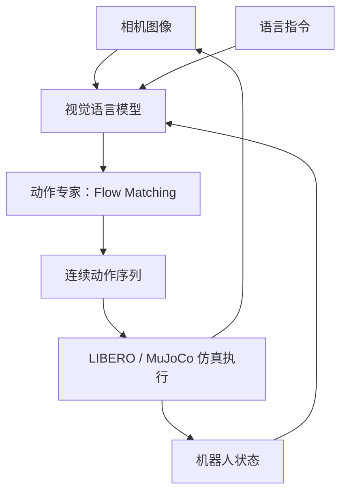

# VLA 模型学习与仿真部署阶段总结

## 一、已完成工作

本阶段主要围绕视觉语言动作模型（VLA）开展理论学习与仿真实验。

- 在 WSL2 Ubuntu 24.04 中完成 LeRobot、PyTorch、CUDA、LIBERO 和 MuJoCo 环境搭建。
- 完成 SmolVLA 预训练模型下载与本地部署，实现 RTX 4070 Laptop GPU 推理。
- 解决模型与仿真环境之间的相机名称映射问题，打通图像输入、模型推理、动作输出与仿真执行的完整流程。
- 完成 LIBERO-Spatial Task 0 抓取放置实验，成功完成 1/1 次测试，并生成实验视频。
- 初步搭建基于 FastAPI 的 VLA 可视化仿真平台，已完成网页搭建与服务启动，目前正在调试前后端通信及仿真画面显示。

## 二、VLA 基本原理

VLA（Vision-Language-Action）是一种将视觉感知、语言理解与机器人动作生成相结合的模型。其输入主要包括相机图像、自然语言指令和机器人自身状态，输出为连续的机器人动作序列。

本阶段学习了 Transformer、自注意力机制以及 SmolVLA 的基本网络架构。SmolVLA 主要由两个模块组成：

- **视觉语言模型（VLM）**：提取并融合视觉、语言及机器人状态相关特征，为动作生成提供条件信息。
- **动作专家（Action Expert）**：利用 Flow Matching，将随机噪声逐步转换为符合当前任务条件的连续动作序列。

通过不断获取环境观测、预测动作并执行，形成闭环控制流程。

目前仅完成单次测试，主要验证系统部署和闭环推理的可行性，尚不能据此评价模型整体性能。本阶段使用预训练模型进行推理，尚未开展自主训练或微调。

## 三、下一阶段计划

- 完善 VLA 可视化仿真平台，实现机械臂实时显示与交互控制。
- 自定义物体位置和语言指令，开展简单抓取与放置实验。
- 深入学习 SmolVLA 源码、Transformer 和 Flow Matching 的具体实现。
- 开展多任务、多初始位置的基线实验，分析模型成功率、推理效率及空间泛化能力，为后续模型改进与科研工作奠定基础。

## 参考资料

- [SmolVLA 原始论文](https://arxiv.org/abs/2506.01844)
- [LeRobot 开源项目](https://github.com/huggingface/lerobot)
