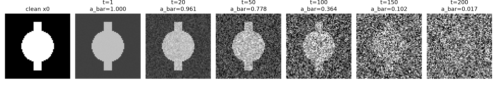
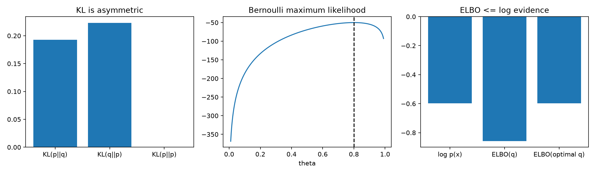
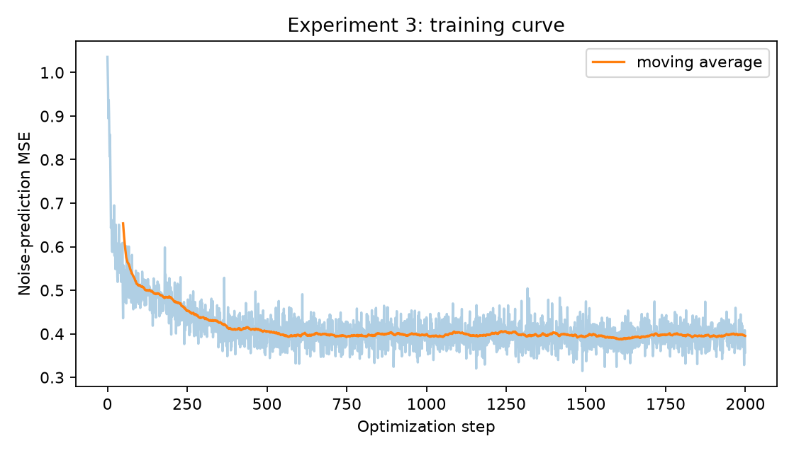
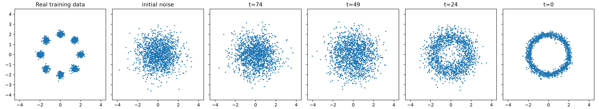
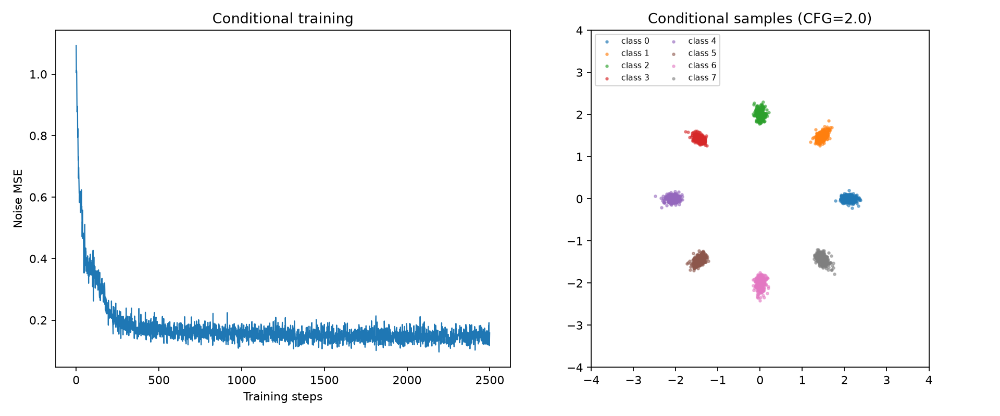

# DDPM 扩散模型实验记录：从加噪到条件生成

在学完扩散模型的基本概念和 DDPM 推导后，我发现只看公式仍然很难把训练、采样两个过程联系起来。这次用五个小实验把它们拆开：先验证加噪公式，再研究 KL、MLE 和 ELBO，最后训练一个二维 DDPM，让模型从随机点中生成具有八簇结构的数据，并尝试通过条件控制生成位置。

实验环境为 **Ubuntu 24.04（WSL2）+ Python + NumPy + PyTorch + Matplotlib**。实验 1 使用简单图像，其余实验主要使用二维数据。选择二维点云不是为了模拟真实图片，而是因为它可以直接画出数据分布，比一开始训练大图像更容易观察模型是否学到了东西。

> **图片说明**：文中的图片统一引用 Quartz 项目的 `content/assets/`。本文预定放在 `content/第三周实验/`，因此图片路径写成 `../assets/文件名.png`。图片可替换为我自己本地完整训练的结果。此前整理的实验 3、4、5 配图来自快速演示：实验 3 训练 500 次，实验 4 使用该权重，实验 5 训练 600 次、CFG=2.0；它们不是 2000/2500 次训练的结果。

## 一、实验安排

| 实验 | 研究的问题 | 运行文件 | 图片 |
| --- | --- | --- | --- |
| 1 | 连续加噪和一步加噪为什么等价？ | `experiment1.py` | `01_forward_diffusion.png` |
| 2 | KL、MLE 和 ELBO 分别解决什么问题？ | `experiment2.py` | `02_kl_mle_elbo.png` |
| 3 | 神经网络怎样学习预测噪声？ | `experiment3.py` | `03_training_loss.png` |
| 4 | 模型如何从纯噪声生成新数据？ | `experiment4.py` | `04_reverse_generation.png` |
| 5 | 条件信息如何控制生成结果？ | `experiment5.py` | `05_conditional_generation.png` |


## 二、实验 1：前向扩散

### 1. 验证的原理

DDPM 的前向过程不需要训练网络，而是按照事先设置好的噪声日程，把原始数据逐渐变成噪声：

$$
q(x_t\mid x_{t-1})=\mathcal N(\sqrt{\alpha_t}x_{t-1},\beta_t I)
$$

其中 $\beta_t$ 控制当前步新噪声的方差，$\alpha_t=1-\beta_t$。令 $\bar\alpha_t=\prod_{s=1}^{t}\alpha_s$，可以直接从 $x_0$ 采样任意一步的 $x_t$：

$$
\boxed{x_t=\sqrt{\bar\alpha_t}x_0+\sqrt{1-\bar\alpha_t}\epsilon},\qquad \epsilon\sim\mathcal N(0,I)
$$

这里 $x_0$ 是原图，$x_t$ 是带噪图，$\epsilon$ 是标准高斯噪声。两个平方根是幅度系数，不是“保留多少百分比的像素”。

### 2. 关键代码

```python
T = 200
beta = np.linspace(1e-4, 0.04, T)
alpha = 1.0 - beta
alpha_bar = np.cumprod(alpha)

# 直接生成第 t 步的带噪图像，t 是从 0 开始的数组索引
noise = np.random.randn(*x0.shape)
xt = np.sqrt(alpha_bar[t]) * x0 + np.sqrt(1 - alpha_bar[t]) * noise
```

为了比较“逐步加噪”和“直接加噪”，程序还做了大量独立采样，对比两者的均值与方差，而不是直接比较单次生成的像素值。

### 3. 效果与分析



图中越往后，原始结构越难辨认。这与 $\bar\alpha_t$ 逐渐减小一致：原图前面的系数下降，噪声项的系数增大。

一次使用固定种子的运行结果如下：

```text
Theory:     mean=0.0917, var=0.9828
Sequential: mean=0.0942, var=0.9827
Direct:     mean=0.0939, var=0.9843
```

两种采样方式的统计量很接近，说明它们对应相同的条件分布；但各自抽到的噪声不同，所以单次结果不会完全一样。**直接采样公式的价值在于：训练时可以随机抽取时间步 $t$，不必从第 1 步一路加噪到第 $t$ 步。**

## 三、实验 2：KL、MLE 和 ELBO

这部分没有训练网络，主要是用几个小概率模型验证后面 DDPM 损失函数涉及的数学概念。

### 1. KL 散度：概率分布的差异有方向

对于两个离散分布 $p$、$q$：

$$
D_{\mathrm{KL}}(p\|q)=\sum_x p(x)\log\frac{p(x)}{q(x)}
$$

程序中令 $p=(0.8,0.2)$、$q=(0.5,0.5)$：

```python
def kl(p, q):
    return float(np.sum(p * np.log(p / q)))

p = np.array([0.8, 0.2])
q = np.array([0.5, 0.5])
print(kl(p, q), kl(q, p), kl(p, p))
```

结果分别约为 `0.192745`、`0.223144` 和 `0`。交换 $p$ 和 $q$ 后数值改变了，所以 KL 一般不是对称距离；同一分布与自身的 KL 为零。

### 2. MLE：让模型参数更能解释观测数据

假设投掷硬币 100 次，其中 80 次正面、20 次反面。如果正面概率是 $\theta$，忽略与参数无关的常数，对数似然为：

$$
\ell(\theta)=80\log\theta+20\log(1-\theta)
$$

```python
theta = np.linspace(0.01, 0.99, 300)
log_likelihood = 80 * np.log(theta) + 20 * np.log(1 - theta)
best = theta[np.argmax(log_likelihood)]
```

曲线的最大值出现在 $\theta\approx0.8$，符合直觉：观测到 80% 正面，最优概率估计也是 0.8。最大似然的思路是让真实数据在模型下有更高的概率。

### 3. ELBO：算不出似然时先优化下界

带潜变量的生成模型往往难以直接计算 $\log p_\theta(x)$。引入辅助后验 $q(z\mid x)$，有：

$$
\log p_\theta(x)=\mathrm{ELBO}+D_{\mathrm{KL}}\big(q(z\mid x)\|p_\theta(z\mid x)\big)
$$

由于 KL 非负，$\mathrm{ELBO}\le\log p_\theta(x)$。实验用二值潜变量计算了这个等式：

```python
prior = np.array([0.5, 0.5])
p_x1_given_z = np.array([0.2, 0.9])
joint = prior * p_x1_given_z
p_x1 = joint.sum()
posterior = joint / p_x1
trial_q = np.array([0.5, 0.5])
elbo = np.sum(trial_q * (np.log(joint) - np.log(trial_q)))
gap = kl(trial_q, posterior)
```

输出：

```text
log p(x=1)       = -0.597837
ELBO(q)          = -0.857399
KL(q||posterior) =  0.259562
ELBO + KL        = -0.597837
```

### 4. 效果与分析




## 四、实验 3：训练噪声预测网络

前两个实验都没有真正训练扩散模型。实验 3 开始使用 PyTorch 训练一个 `NoiseMLP`，让它学会在不同噪声阶段估计所加的噪声。

### 1. 数据与任务

训练集是围绕圆周排布的八簇二维高斯点。第 $k$ 簇的中心为：

$$
c_k=(2\cos(2\pi k/8),\ 2\sin(2\pi k/8))
$$

对中心加入小幅高斯扰动，就得到训练点 $x_0$。训练过程随机选择时间步 $t$ 和噪声 $\epsilon$，生成 $x_t$；网络输入 $(x_t,t)$，输出 $\hat\epsilon$。

目标函数为：

$$
\mathcal L_{\mathrm{simple}}=\mathbb E\left[\|\epsilon-\epsilon_\theta(x_t,t)\|_2^2\right]
$$

程序实际取 batch 和二维分量上的平均 MSE，因此和公式里直接写平方误差之和相比，只差固定的缩放系数。

### 2. 训练代码

```python
for step in range(1, args.steps + 1):
    x0 = sample_eight_gaussians(args.batch_size, device)
    t = torch.randint(0, args.T, (args.batch_size,), device=device)
    noise = torch.randn_like(x0)
    xt = sch.noisy(x0, t, noise)

    pred = model(xt, t)
    loss = ((pred - noise) ** 2).mean()

    optimizer.zero_grad()
    loss.backward()
    optimizer.step()
```

这个过程中的真实噪声标签 `noise` 是程序自己生成的，不需要额外标注数据。`--steps 2000` 是优化器更新 2000 次，`--T 100` 才表示扩散共有 100 个时间步，这两个参数不能混淆。

### 3. 效果与分析



在此前 500 次迭代的快速演示中，第一步 MSE 约为 `1.13114`，第 500 步约为 `0.36689`。曲线总体下降，说明网络逐渐学到了噪声与带噪坐标之间的关系。由于每批数据和噪声都重新采样，曲线会波动；而且给定 $x_t$ 和 $t$ 后，原始噪声也未必能唯一确定，因此 MSE 不要求降到零。

训练完成后保存 `results/exp3/unconditional_ddpm.pt`。这份权重是实验 4 的输入。

## 五、实验 4：从随机噪声反向生成八簇点云

### 1. 生成过程

实验 4 加载实验 3 的权重，从标准高斯噪声 $x_T\sim\mathcal N(0,I)$ 开始，逐步计算 $x_{T-1},x_{T-2},\ldots,x_0$。

网络首先预测当前噪声 $\hat\epsilon=\epsilon_\theta(x_t,t)$，再计算反向均值：

$$
\mu_\theta(x_t,t)=\frac{1}{\sqrt{\alpha_t}}\left(x_t-\frac{\beta_t}{\sqrt{1-\bar\alpha_t}}\hat\epsilon\right)
$$

然后根据反向方差采样：

$$
x_{t-1}=\mu_\theta(x_t,t)+\sigma_tz,\qquad z\sim\mathcal N(0,I)
$$

在这个实现中，反向方差使用固定的后验方差，最后一步不额外加入噪声。

### 2. 关键代码

```python
x = torch.randn(n, 2, device=device)
for i in reversed(range(sch.T)):
    t = torch.full((n,), i, device=device, dtype=torch.long)
    e = model(x, t)
    mean = (x - sch.beta[i] / torch.sqrt(1 - sch.ab[i]) * e) \
           / torch.sqrt(sch.alpha[i])
    x = mean if i == 0 else \
        mean + sch.posterior_var[i].sqrt() * torch.randn_like(x)
```

这里不能直接写成 `x - e`，因为每一步的信号缩放和噪声强度都不同。

### 3. 效果与分析



图中有训练分布、初始噪声和若干反向采样阶段。开始时样本集中在原点附近，随着反向迭代，逐步出现训练集的八簇结构。这里使用的是实验 3 的 500 次训练权重，分布不一定完全贴合真实点簇；模型训练得更充分时通常更清楚。

这个实验让我区分了“生成”和“修复”：**生成阶段没有指定要恢复的原始点 $x_0$，模型利用学到的分布，从一批新的随机噪声生成新的数据。**

## 六、实验 5：条件扩散与 CFG

前面的模型学习的是整体分布 $p_\theta(x)$，不能指定八个点簇中生成哪一个。实验 5 加入类别标签 $c\in\{0,\dots,7\}$，学习条件分布 $p_\theta(x\mid c)$：

$$
\hat\epsilon=\epsilon_\theta(x_t,t,c)
$$

### 1. 怎样加入条件

程序把类别转换为 one-hot 特征，再和二维坐标、时间特征拼接。额外保留 `-1` 表示没有类别条件，供 CFG 使用。训练时约 15% 的标签会随机变成 `-1`：

```python
x0, labels = sample_eight_gaussians(args.batch_size, device, labels=True)
t = torch.randint(0, args.T, (args.batch_size,), device=device)
noise = torch.randn_like(x0)
xt = sch.noisy(x0, t, noise)

train_labels = labels.clone()
train_labels[torch.rand(args.batch_size, device=device) < 0.15] = -1
loss = ((model(xt, t, train_labels) - noise) ** 2).mean()
```

这样同一个网络能够学习有条件和无条件两种噪声预测。

### 2. CFG 如何起作用

反向采样时计算两个预测，再进行组合：

$$
\epsilon_{\mathrm{CFG}}=\epsilon_{\mathrm{uncond}}+s\left(\epsilon_{\mathrm{cond}}-\epsilon_{\mathrm{uncond}}\right)
$$

```python
e_cond = model(x, t, condition)
e_null = model(x, t, torch.full_like(condition, -1))
e = e_null + guidance * (e_cond - e_null)
```

在这个公式中，`guidance=1` 就是直接使用条件预测；`guidance=2` 则放大条件和无条件预测之间的差异。引导强度越大不代表效果一定越好，过高时可能牺牲生成质量或多样性。

### 3. 效果与分析



此前 600 次迭代、CFG=2.0 的快速演示中，MSE 从约 `0.97524` 降到约 `0.17933`。效果图中，不同条件对应不同类别的点云；如果点集中在指定的圆周位置，就说明模型不仅学到了整体分布，还学到了类别和位置的对应关系。

这里的条件只是**类别编号**，并不是文本提示词。若要比较不同 CFG 强度，最好加载同一份训练好的权重，并固定初始随机噪声；当前脚本每次运行都会重新训练。

