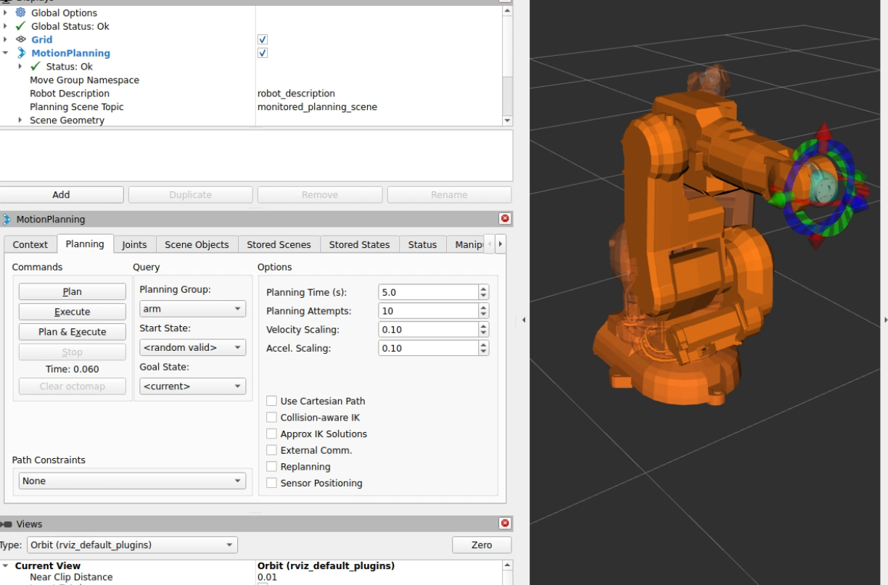
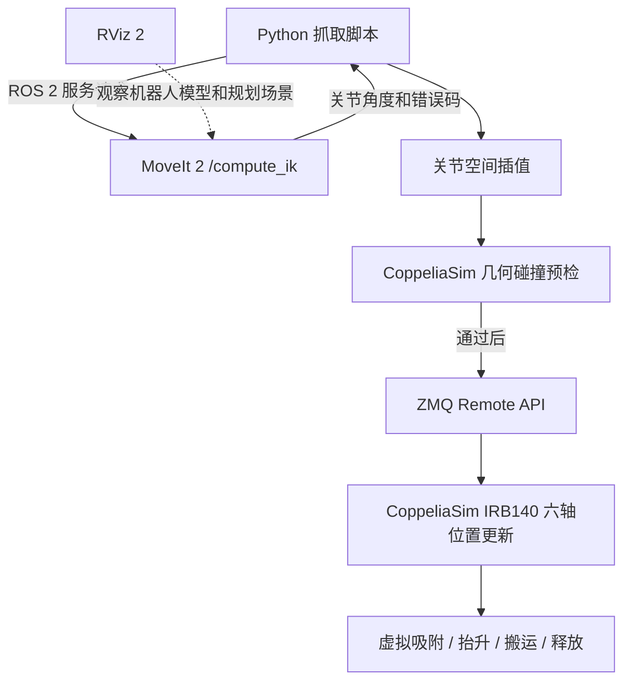
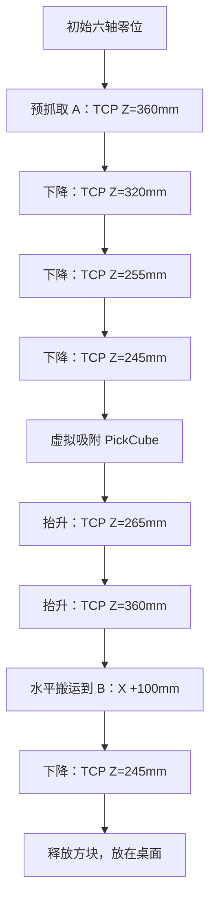

# 用 ROS 2 + MoveIt 2 + RViz 2 + CoppeliaSim 做一次机械臂抓取实验

这周主以一套 ABB IRB140 六轴机械臂的仿真：先让单个关节按指令转动，再尝试让末端到达指定位置，最后完成从 A 点抓起方块、移动 100 mm、放到 B 点的流程。过程中最花时间的不是写抓取动作，而是弄清楚各个软件在做什么，以及它们的机器人模型为什么会出现不一致。

环境是 Windows 11 + WSL2 Ubuntu 24.04，使用 ROS 2 Jazzy、MoveIt 2、RViz 2、CoppeliaSim Edu 和 Python。下面记录的是已经实际测试过的过程；

## 0. 实验画面

### RViz 中的机器人模型



*图 1：RViz 2 中的机器人模型和 MoveIt 调试界面。*

### 抓取与放置演示


[视频无法加载时，点击打开 MP4 文件](../assets/仿真抓取.mp4)

这段视频展示的是 CoppeliaSim **停止动力学仿真状态下**的运动学抓取演示：Python 控制关节位置，使用父子对象关系模拟吸盘，并非真实吸盘的动力学仿真。

视频与图片放在 Quartz 项目的 `content/assets/` 下，本文位于 `content/第三周实验/`。这里使用 Quartz 的视频嵌入语法 ``，在启用 ObsidianFlavoredMarkdown 视频功能时，网页会显示带控制条的播放器。

---

## 1. 实验是怎么开始的

前面学了旋转矩阵、齐次变换、DH 参数和正逆运动学，公式能看懂一部分，但一直不清楚这些知识放进机器人系统后究竟怎么用。于是我给自己定了一个具体目标：让 IRB140 从工作台上抓起一个方块，平移 100 mm，再放回桌面。

实际做下来，这个看起来很简单的动作至少涉及：

1. 建立机械臂的几何及关节模型；

2. 用目标位置、目标姿态描述任务；

3. 由逆运动学（IK）求出目标关节角度；

4. 生成关节运动过程，并进行碰撞验证；

5. 通过通信接口驱动仿真中的机械臂；

6. 处理抓取、搬运和释放等离散任务状态；

7. 对比规划结果与实际仿真结果，定位误差来源。

。

---
## 2. 软件环境与系统分工

| 软件／技术 | 使用环境 | 在本项目中的主要职责 |
|---|---|---|
| Windows 11 | 主机 | 运行 CoppeliaSim 图形界面 |
| WSL2 Ubuntu 24.04 | Linux 子系统 | 运行 ROS 2、MoveIt 2、Python 脚本 |
| ROS 2 Jazzy | Ubuntu | 节点、消息、话题、服务、动作等通信基础设施 |
| MoveIt 2 | Ubuntu | IK 求解、机器人模型、规划场景、碰撞检查与规划接口 |
| RViz 2 | Ubuntu | 显示机器人模型、坐标系、规划场景和轨迹；本身不是 IK 引擎 |
| CoppeliaSim Edu | Windows | 机器人与工作台三维场景、关节状态、几何检测、虚拟对象操作 |
| Python + `rclpy` | Ubuntu | 请求 IK、组织状态机、采样运动路径 |
| ZMQ Remote API | Ubuntu ↔ Windows | Python 读取/设置 CoppeliaSim 对象与关节状态 |
| URDF / Xacro | ROS 机器人描述文件 | 连杆、关节、轴向、视觉模型与碰撞模型 |
| SRDF | MoveIt 语义配置 | 规划组、末端、禁用碰撞配对等 |

### 2.1 当前实际跑通的控制链




---
## 3. 重要概念：关节角、坐标系、TCP 与 FK / IK

### 3.1 关节空间与角度单位

IRB140 有六个旋转关节。关节状态可以用向量表示：

$$

\mathbf q = [q_1,q_2,q_3,q_4,q_5,q_6]^T

$$

ROS 相关机器人接口通常使用**弧度**而不是角度。转换公式为：

$$

\theta_{\mathrm{rad}} = \theta_{\mathrm{deg}}\frac{\pi}{180}

$$

例如 $3^\circ\approx0.05236\ \mathrm{rad}$。

本次校准过一个特别重要的关系：**CoppeliaSim 中 J5 的关节零位相对于 ROS 模型偏移 −90°**。

$$

q_{5,\mathrm{Sim}} = q_{5,\mathrm{ROS}}-\frac{\pi}{2}

$$

因此脚本中统一使用：

```python

OFFSETS = [0, 0, 0, 0, -math.pi / 2, 0]

```

这表示 **ROS 与 CoppeliaSim 的关节角表示存在固定映射**，并不意味着机器人必须重新标零。更一般的模型还要检查关节轴是否反向，而不能只比较零位数值。

### 3.2 世界坐标系与基座坐标系

\- **世界坐标系（World）：** CoppeliaSim 场景中的全局参考系。`sim.getObjectPosition(obj, -1)` 获取对象相对于世界坐标系的位置。

\- **机器人基座坐标系（Base）：** 固定在机器人底座附近。MoveIt 当前使用 `robot_base` 作为目标坐标参考系。

\- **关节 / 连杆坐标系：** 用于描述各关节的旋转轴、连杆之间的相对位置与姿态。

\- **TCP 坐标系：** 用于定义工具实际工作的参考点及其朝向。

例如，同一个预抓取点 A 在两个坐标系中的数值为：

| 参考系 | A 点位置（m） |
|---|---|
| CoppeliaSim 世界坐标 | `(0.25, 0.05, 0.36)` |
| 当前标定下的 ROS `robot_base` | `(0.175, 0.125, 0.36)` |

当前场景的实验脚本采用了以下已验证的位置映射：

$$

\begin{aligned}

x_{\mathrm{ROS}} &= x_{\mathrm{World}}-0.075\\

y_{\mathrm{ROS}} &= y_{\mathrm{World}}+0.075\\

z_{\mathrm{ROS}} &= z_{\mathrm{World}}

\end{aligned}

$$

这里的固定平移是当前场景与当前坐标约定下的标定结果；对任意两个有相对旋转的坐标系，一般应该使用完整的齐次变换：

$$

{}^BT_W = \begin{bmatrix} {}^BR_W & {}^B\mathbf t_W \\ 0 & 1 \end{bmatrix}

$$

$$

{}^B\mathbf p = {}^BR_W\,{}^W\mathbf p+{}^B\mathbf t_W

$$

### 3.3 TCP 到底是什么

TCP（Tool Center Point，工具中心点）是工具执行操作的参考点，可以是吸盘接触点、夹爪中心等，不必与第六关节原点重合。

本实验使用 CoppeliaSim 场景中的：

```python

tip = sim.getObject('/IRB140/tip')

world_xyz = sim.getObjectPosition(tip, -1)

```

当 TCP 在世界坐标下约为 `(0.25, 0.05, 0.245)` m 时，就表示它位于方块正上方。由于方块顶面高度为 0.240 m，TCP 到顶面的间隙约为 5 mm。

在 MoveIt 的 IK 请求中，使用的是 `link_6` 作为求解末端；所以必须把**TCP 目标位姿**转换为**`link_6` 目标位姿**。在本次固定工具朝向下，脚本采用 `link_6` 目标高度 = TCP 目标高度 + 0.0604 m。

> [!warning] 重要区别

> `link_6` 原点、可视化模型的几何中心、碰撞体中心、CoppeliaSim 的 `tip`，并非同一个点。之前几次校准误判，就是把不同坐标系中的原点直接相减，忽略了轴向、旋转和网格内顶点坐标。

### 3.4 正运动学与逆运动学

**正运动学 FK：** 已知六个关节角，计算 TCP 的位置和方向。

$$

{}^{B}T_{\mathrm{TCP}}=FK(\mathbf q)

$$

**逆运动学 IK：** 已知希望到达的末端位姿，求可行的关节角。

$$

\mathbf q^* = IK({}^{B}T_{\mathrm{TCP}}^*)

$$

实际调用方式是：

```python

client = node.create_client(

    GetPositionIK,

    '/compute_ik'

)

future = client.call_async(request)

rclpy.spin_until_future_complete(node, future)

result = future.result()

# MoveIt 通过 ROS 2 服务响应返回关节角

joint_names = result.solution.joint_state.name

joint_positions = result.solution.joint_state.position

```

准确地说：Python 向 ROS 2 的 `/compute_ik` 服务发送请求，MoveIt 2 的 IK 求解模块计算结果，再通过 ROS 2 服务响应返回给 Python。**RViz 不负责计算这些关节角。**

### 3.5 IK、规划和执行不是一回事

| 过程 | 输入 | 输出 / 作用 |
|---|---|---|
| FK | 关节角 | 末端位姿 |
| IK | 目标末端位姿 | 一组六轴关节角，或无解 |
| 路径规划 | 当前状态、目标状态与环境 | 避障路径 |
| 时间参数化 | 几何路径、速度加速度限制 | 带时间信息的运动轨迹 |
| 轨迹执行 | 轨迹与控制器接口 | 仿真或实体机器人的运动 |

本次成功演示的关节路径主要采用线性插值：

$$

\mathbf q(s)=(1-s)\mathbf q_{\mathrm{start}}+s\mathbf q_{\mathrm{goal}},\quad 0\le s\le1

$$

它不保证 TCP 在笛卡尔空间走直线，也不自动保证关节速度、加速度或连续碰撞安全。

---
## 4. 从一个关节转动到自动抓取：实际开发过程

### 阶段 A：环境安装与通信打通

1. 在 WSL2 Ubuntu 24.04 安装 ROS 2 Jazzy 与 MoveIt 2。

2. 建立工作空间 `~/robot_arm_ws`，编译相关描述与配置功能包。

3. Windows 中启动 CoppeliaSim Edu，打开 IRB140 场景。

4. Python 通过 ZMQ Remote API 连接本机 `localhost:23000`。

5. 成功读取仿真时间、目标位置、关节状态并设置关节位置。

常用环境命令：

```bash

source /opt/ros/jazzy/setup.bash

source ~/robot_arm_ws/install/setup.bash

source ~/coppelia_ros2_venv/bin/activate

```

启动 MoveIt 演示环境：

```bash

ros2 launch irb140_moveit_config demo.launch.py

```

### 阶段 B：认识 ROS 2 机器人模型

工作空间中包含机器人描述和 MoveIt 配置，例如：

```text

~/robot_arm_ws/

├── src/

│   ├── irb140_description/

│   │   └── urdf/irb140.urdf

│   ├── irb140_moveit_config/

│   │   ├── config/

│   │   └── launch/

│   └── coppelia_arm_control/

│       └── coppelia_arm_control/

│           └── arm_control_node.py

├── pick_and_place_auto.py

└── [若干分步测试脚本]

```

\- **URDF：** 机器人结构与几何定义。

\- **SRDF：** MoveIt 规划组、语义关系与碰撞规则。

\- **MoveIt `demo.launch.py`：** 启动用于调试的 MoveIt/RViz 环境。

\- **`coppelia_arm_control`：** 早期 ROS 2 节点测试，曾成功订阅 `/arm_target` 并控制仿真机械臂。

### 阶段 C：让一个关节动作

早期通过 ROS 2 控制接口/桥接方案，验证 J5 小角度运动；也通过 ZMQ 直接设置 CoppeliaSim 关节角。

例如直接控制（只作为原理示例，**不是完整运动轨迹**）：

```python

from coppeliasim_zmqremoteapi_client import RemoteAPIClient

import math

sim = RemoteAPIClient(host='localhost', port=23000).require('sim')

robot = sim.getObject('/IRB140')

joints = sim.getObjectsInTree(robot, sim.object_joint_type, 0)

# ROS J5 = +3°，对应 CoppeliaSim J5 = -87°

sim.setJointPosition(joints[4], math.radians(-87))

```

理解要点： 关节角是运动控制的底层变量；TCP 位姿是任务层面的目标。机器人控制要在两者之间建立映射。

### 阶段 D：MoveIt IK 与 TCP 标定

初始时发现 MoveIt 与 CoppeliaSim 的 J6 旋转行为不一致：单独旋转 J6 后，两套模型的 TCP 位置差约 **24.64 mm**。这说明不能只凭“URDF 能显示”就认为模型正确。

随后检查并调整了 J6 的轴向、关节原点和工具变换。针对 J6 的独立转动测试，验证了 TCP 不再错误地绕轴平移；但完整的多姿态 FK、碰撞几何一致性仍需进一步验收。

最终取得一组预抓取 A 点的 IK 候选解：

| 关节 | ROS 角度（°） |
|---|---:|
| J1 | −22.839 |
| J2 | −26.750 |
| J3 | −15.032 |
| J4 | 0.000 |
| J5 | +41.782 |
| J6 | −22.839 |

在 CoppeliaSim 中设置该关节构型后，TCP 到 A 点的位置误差约为 **0.108 mm**。

### 阶段 E：碰撞模型不一致与排查

MoveIt 开启 IK 碰撞检查时：

```python

ik.avoid_collisions = True

```

针对原预抓取目标，曾返回 `-31`（未找到满足约束的 IK 解）。关闭碰撞检查后可以得到上述关节构型：

```python

ik.avoid_collisions = False

```

进一步诊断发现：

| 路径进度 | MoveIt 报告的 `link_4 ↔ link_6` 穿透深度 | CoppeliaSim 对应形状间隙 |
|---|---:|---:|
| 0% | 未报告碰撞 | 5.168 mm |
| 60% | 未报告碰撞 | 5.298 mm |
| 65% | 0.359 mm | 5.207 mm |
| 80% | 2.806 mm | 4.720 mm |
| 100% | 4.315 mm | 4.469 mm |

CoppeliaSim 中被检查的相应形状是 `link5_visible`（J4 所属）与 `link7_visible`（J6 所属）。MoveIt 的 `link_4` 使用了 10 个 DAE 碰撞网格，而 `link_6` 使用简化圆柱体，二者不一定与 CoppeliaSim 的形状完全等价。

在此过程中尝试过调整碰撞圆柱体，但部分修改导致机器人零位也报告自碰撞，因此**回退到了零位有效的版本**。这一问题尚未被彻底修复。


### 阶段 F：先在 CoppeliaSim 完成运动学抓取

为了不让碰撞网格校准阻塞整个入门实验，采用了一个**明确限定的仿真原型方案**：

\- MoveIt 只求目标关节角，暂不使用尚未校准的碰撞约束；

\- Python 对关节空间插值；

\- CoppeliaSim 对路径做离散几何检查；

\- 通过 ZMQ 逐步设置关节角；

\- 使用对象父子关系模拟吸盘的吸附与释放。

已成功执行的流程：



#### 场景参数与最终结果

| 对象 / 指标 | 实验数值 |
|---|---|
| 工作台中心（世界系） | `(0.25, 0.05, 0.10)` m |
| 工作台上表面 | `Z = 0.20 m` |
| 方块边长 | 40 mm |
| 方块初始中心 | `(0.25, 0.05, 0.22)` m |
| 预抓取 A | `(0.25, 0.05, 0.36)` m |
| 预放置 B | `(0.35, 0.05, 0.36)` m |
| 吸附时 TCP 高度 | 245 mm |
| 吸附时 TCP 到方块顶面间隙 | 约 4.895 mm |
| 水平搬运位移 | 100.000 mm |
| 最终方块中心 | `(0.35, 0.05, 0.22)` m |
| 最终方块底面高度 | 200.000 mm |
| 最终方块目标误差（脚本输出） | 0.000 mm |
| 放置阶段 TCP 误差 | 0.105 mm |

吸附方式：

```python

# True：调整父对象时保留方块当前世界位姿

sim.setObjectParent(cube, tip, True)

# 搬运完成后解除父子关系，同样保留当前世界位姿

sim.setObjectParent(cube, -1, True)

```

这是一种**运动学层面的虚拟吸盘**。它能让方块跟随 TCP，但不是物理吸附力、接触摩擦或真实吸盘负压的模拟。

### 阶段 G：整合一键脚本

完成分步实验后，将动作合入 `~/robot_arm_ws/pick_and_place_auto.py`，准备形成“统一预检 → 自动演示”的状态机。

第一次尝试一键脚本时，出现：

```text

RuntimeError: 机械臂不是初始零位。请重新打开原始Test场景

```

原因是此前完成搬运后，机器人仍停留在 B 点附近，而一键脚本要求从初始姿态启动。**因此，一键整合脚本尚未完成完整成功复测**；后续需要加入可靠的场景恢复与状态校验功能。

---
## 5. 踩过的坑，以及为什么会卡住

### 5.1 同一机器人，为什么两套软件会算出不同结果？

因为 **“同名机器人模型”不等于“数学模型完全一致”**。必须分别校验：

1. 关节顺序、零位与旋转方向；

2. 关节原点及旋转轴；

3. 各连杆坐标系与末端工具变换；

4. 可视化网格、碰撞网格的尺寸与变换；

5. 世界坐标与机器人基座坐标之间的完整变换；

6. 实时关节状态与规划场景是否同步。

最核心的运动学验证关系是：

$$

{}^BT_{\mathrm{TCP}}^{\mathrm{MoveIt}}(\mathbf q)

\approx

{}^BT_{\mathrm{TCP}}^{\mathrm{CoppeliaSim}}(\mathbf q)

$$

但 FK 一致**不等于**碰撞模型一致，需要分别验收。


---
## 6. 现在怎么理解这几套软件

**ROS 2 是通信与软件组织框架。** 使用节点、话题、消息、服务、动作，让不同程序协同工作。

**MoveIt 2 是机器人运动学与规划组件。** 本实验实际使用 `/compute_ik` 服务获取六轴关节角；它还具有规划场景、碰撞检测与轨迹规划能力，但完整规划执行链仍需调试。

**RViz 2 是观察和交互工具。** 可以显示模型、TF 坐标系、规划场景和规划轨迹。它不是求解 IK 的主体，也不会因为显示了轨迹就自动驱动 CoppeliaSim。

**CoppeliaSim 是虚拟机器人与场景的运行环境。** 它承载 IRB140、方块、工作台，支持设置关节、读取物体位姿、几何检测、动力学与对象层级操作。本次成功使用的是停止仿真状态下的几何运动演示。

**Python 程序是任务逻辑与集成层。** 它组织各个阶段：调用 MoveIt IK、检查关节跳变、逐点设定关节、检查碰撞、完成吸附与释放。

目前我习惯这样理解整条链路：

> **我用 Python 描述任务，用 ROS 2 调用 MoveIt 算关节角，借助 RViz 理解机器人模型和规划过程，再通过 ZMQ 让 CoppeliaSim 中的机器人执行并验证动作。**

---

### 推荐的本地复现实验命令

启动 MoveIt（终端一）：

```bash

source /opt/ros/jazzy/setup.bash

source ~/robot_arm_ws/install/setup.bash

ros2 launch irb140_moveit_config demo.launch.py

```

测试 CoppeliaSim ZMQ 连接（终端二，确保 Windows 已打开场景）：

```bash

source ~/coppelia_ros2_venv/bin/activate

python - <<'PY'

from coppeliasim_zmqremoteapi_client import RemoteAPIClient

sim = RemoteAPIClient(host='localhost', port=23000).require('sim')

print('CoppeliaSim 状态:', sim.getSimulationState())

PY

```

查看 MoveIt IK 服务是否存在：

```bash

source /opt/ros/jazzy/setup.bash

ros2 service type /compute_ik

```

一键脚本（**先恢复为初始测试场景，再运行；目前尚待完整成功复测**）：

```bash

source /opt/ros/jazzy/setup.bash

source ~/robot_arm_ws/install/setup.bash

source ~/coppelia_ros2_venv/bin/activate

python ~/robot_arm_ws/pick_and_place_auto.py

```

> [!important] 复现边界

> 这些脚本使用当前特定场景的对象名、固定坐标映射和 J5 角度偏移。不要直接用于其他机器人或实体设备；场景和模型变动后需要重新校验。

---
## 8. 写在最后


从最初通过 ROS 2 让机械臂单关节动作，到使用 MoveIt 求逆运动学，再到在 CoppeliaSim 中完成抓取搬运，我逐步把课堂中的齐次变换、正逆运动学、坐标系和路径插值连接到了实际工程。


目前已经完成了分步的抓取—抬升—搬运—放置演示，方块最终在 B 点释放。下一步不急着加复杂功能，先把场景重置、模型校准和一键脚本复测做好，再继续接 MoveIt 的完整轨迹规划和 ROS 2 控制器。

---